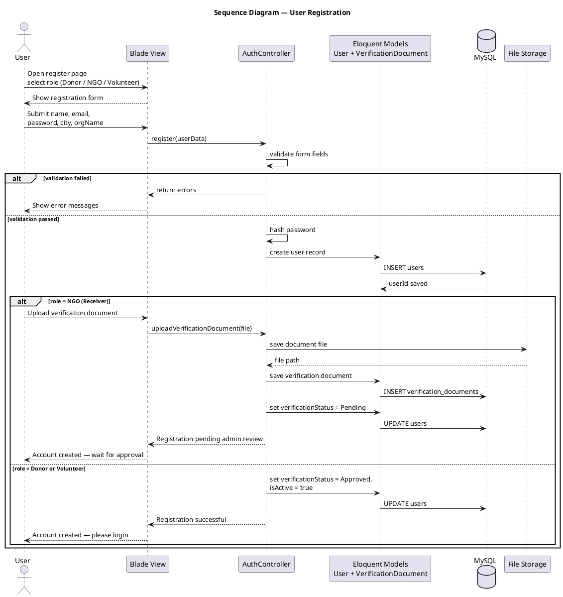
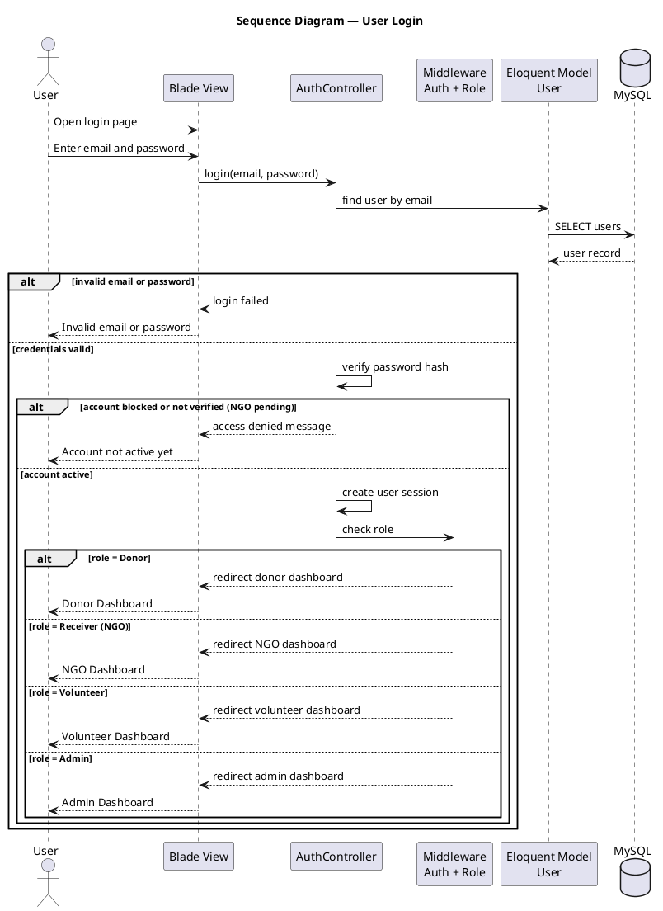
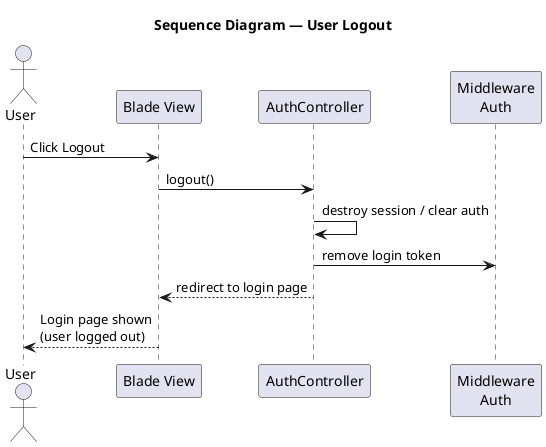
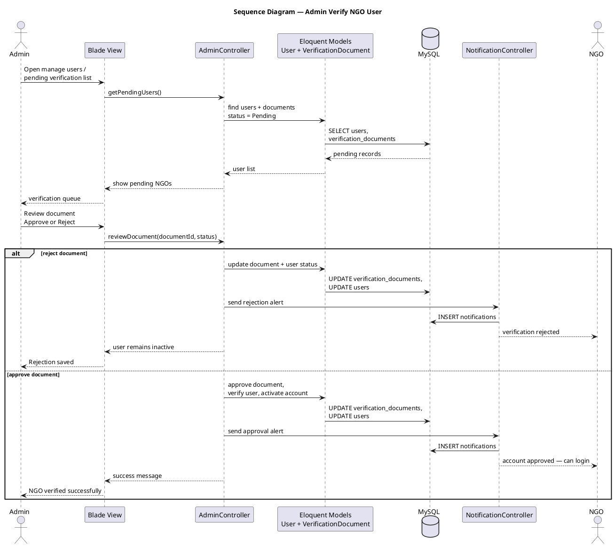
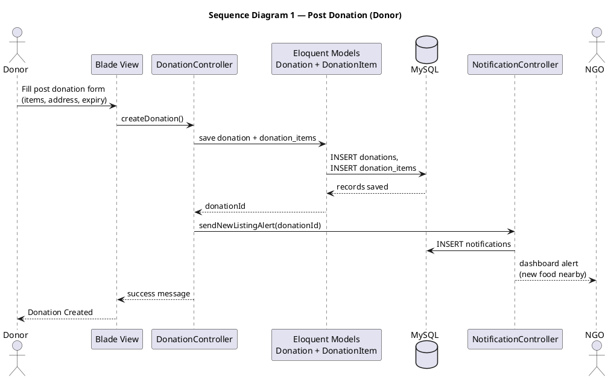
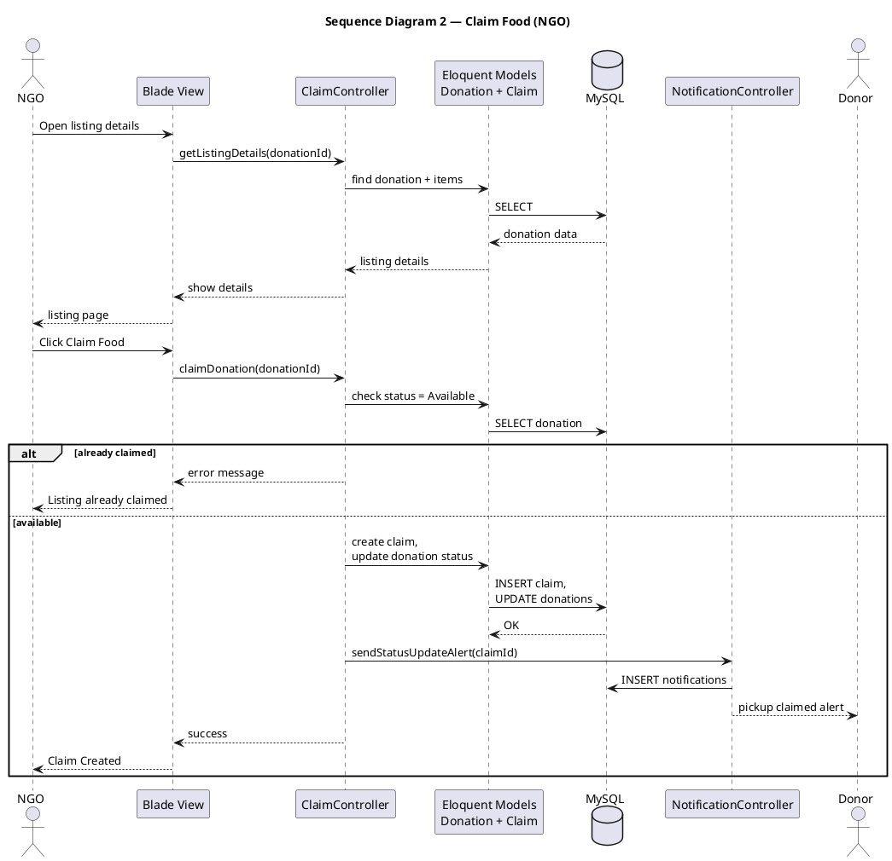
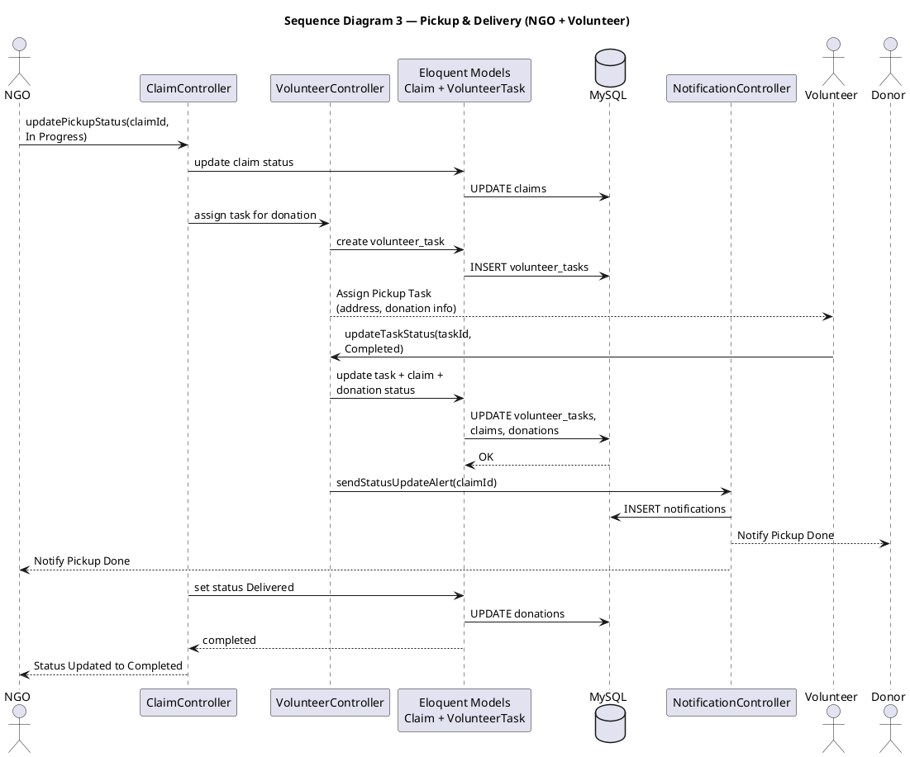
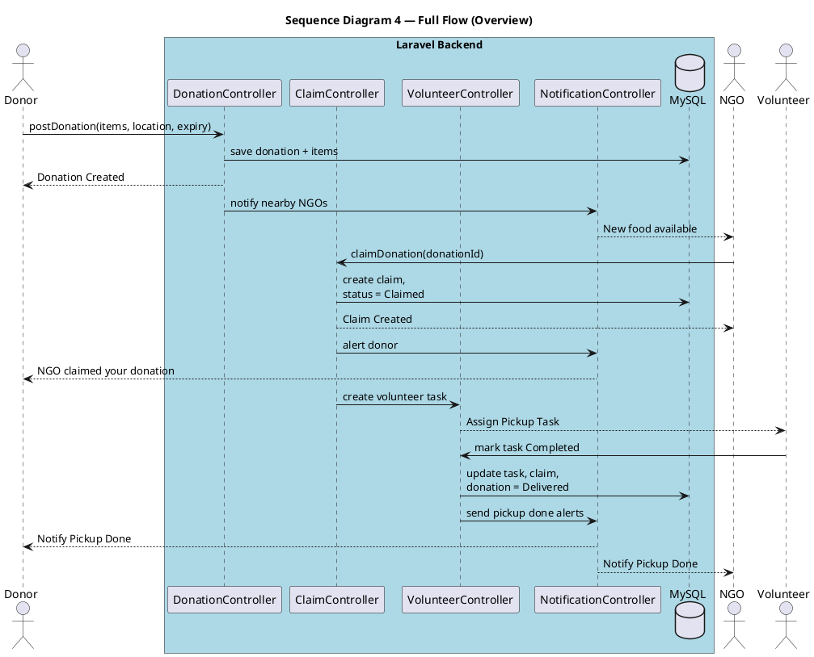
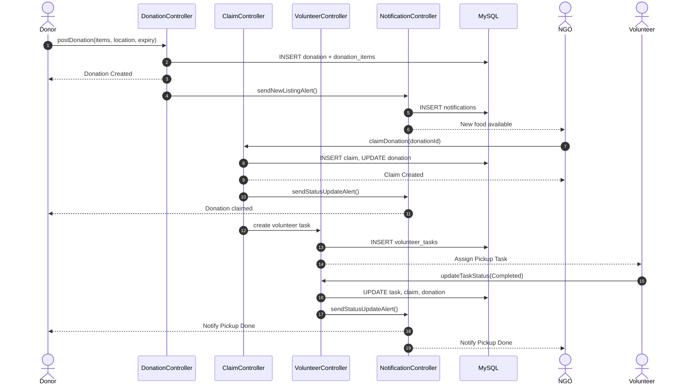
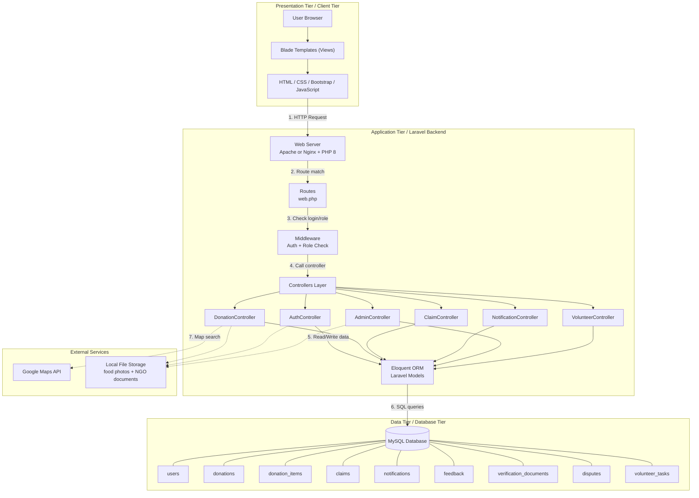

# Design Document
## Community Food Wastage Reduction Portal

> Copy each section into your Word doc as needed. Written in simple language — this is our plan before we start building the system.

## Table of Contents

1. Introduction of Design Document
2. Entity Relationship Diagram (ERD)
3. Sequence Diagrams
4. Architecture Design Diagram
5. Class Diagram
6. Database Design
7. Interface Design
8. Test Cases

## 1. Introduction of Design Document

This design document is a detailed plan for the **Community Food Wastage Reduction Portal**. In the SRS, we already wrote what the system should do. In this document, we will plan *how* the system will work — its structure, data, screens, and main user flows.

Our portal will connect food donors (restaurants, hotels, individuals) with people who need food (NGOs, shelters) and volunteers who can help with pickup. Donors will post extra food, receivers will search and claim it, and admin will check users and listings to keep things safe. This document helps us organize all of that before we start coding.

This document is for our project team, supervisor, and anyone who wants to understand the system layout. We will not repeat the full SRS here, but each design section will link back to the requirements so we do not miss anything important.

### 1.1 Contents of This Document

Our design document has **8 sections**:

| # | Section | What we will include |
|---|---------|----------------------|
| 1 | **Introduction of Design Document** | Why we need this document, what it contains, and why the design phase is important for our project. |
| 2 | **Entity Relationship Diagram (ERD)** | A diagram showing main data items (User, Donation, Donation_Item, Claim, Notification, etc.) and how they connect to each other. |
| 3 | **Sequence Diagrams** | Three main flows: auth & user management, full donation process, and dispute handling. |
| 4 | **Architecture Design Diagram** | A simple picture of how the system is split — user screens, main application logic, database, and any outside services like maps. |
| 5 | **Class Diagram** | Main parts of the system (classes) and what information and actions each part will handle. |
| 6 | **Database Design** | Tables we will create, field names, and how records link together. |
| 7 | **Interface Design** | Wireframes and layout plans for important screens — login, dashboards, post food, browse food, claim food, and admin pages. |
| 8 | **Test Cases** | Test cases to check if main features work as planned after development. |

These sections together form our full design plan — from how data is stored to how users will see and use the portal.

### 1.2 Purpose of the Design Phase in Software Development

The design phase comes after the SRS and before development. In this phase, we plan the system in detail so we know what to build and how pieces fit together.

**Why the design phase matters:**

1. **Clear direction**  
   Before coding, we should know how donor posting connects to NGO claiming, which data we need to store, and what each screen will show. Good planning saves time and avoids redoing work later.

2. **Fewer mistakes early**  
   Wrong table links, missing status fields, or unclear user roles are easier to fix on paper than in code. Diagrams like ERD and sequence diagrams help us spot problems before development.

3. **Same plan for everyone**  
   When screens, database, and system logic all follow one design, the project stays organized. We can add features without breaking what already works.

4. **Helps with testing**  
   Test cases in this document will be based on our planned flows. For example, if we plan that a listing becomes "Claimed" after an NGO claims it, we can test exactly that later.

5. **Required for project submission**  
   For our VU project, the design document is an official deliverable. It also helps explain our system during viva if the examiner asks how we planned the portal.

**For our Food Wastage Portal**, this design phase will turn SRS requirements (registration, food listing, search, claiming, notifications, admin reports) into diagrams, database tables, screen layouts, and test cases. Without this step, we might build things in the wrong order or leave out important features.

## 2. Entity Relationship Diagram (ERD)

### 2.1 What the ERD Shows

The ERD shows what data our portal will store and how different records connect. For example, one donor can post many donations, and **each donation can include multiple food items** (e.g. rice and biryani in one pickup). Each donation can only be claimed by one NGO at a time. Admin can verify users, and the system can send notifications linked to users and donations.

We will include this diagram in our design document with a short explanation of each main entity.

### 2.2 ERD Structure (Entities & Relationships)

Use this structure when creating or checking the diagram.

#### Main Entities

| Entity | Purpose | Key Attributes |
|--------|---------|----------------|
| **User** | All people using the portal | user_id (PK), name, email, password, phone, org_name, address, city, role, verification_status, is_active, created_at |
| **Donation** | One pickup post by a donor (shared address and status) | donation_id (PK), donor_id (FK), pickup_address, city, latitude, longitude, status, admin_approval, rejection_reason, moderated_by (FK), created_at |
| **Donation_Item** | Each food item inside a donation | item_id (PK), donation_id (FK), item_name, category (Veg/Non-Veg), quantity, unit, best_before, photo |
| **Claim** | When an NGO reserves a whole donation | claim_id (PK), donation_id (FK), receiver_id (FK), claim_date, pickup_status, updated_at |
| **Notification** | Alerts sent to users | notification_id (PK), user_id (FK), donation_id (FK), message, type, is_read, created_at |
| **Feedback** | Rating after food pickup | feedback_id (PK), donation_id (FK), receiver_id (FK), rating, comment, created_at |
| **Volunteer_Task** | Pickup job assigned to volunteer | task_id (PK), donation_id (FK), volunteer_id (FK), task_status, assigned_at, completed_at |
| **Verification_Document** | NGO/donor proof uploaded for admin review | document_id (PK), user_id (FK), file_path, status, uploaded_at, reviewed_by (FK), reviewed_at |
| **Dispute** | Complaint raised by donor or NGO on a claim | dispute_id (PK), donation_id (FK), claim_id (FK), raised_by (FK), description, admin_note, status, resolved_by (FK), created_at, resolved_at |

**Role values for User:** Donor, Receiver (NGO), Volunteer, Admin  

**Status values for Donation:** Available, Claimed, Picked Up, Delivered, Expired, Cancelled  

**Pickup status for Claim:** Claimed, In Progress, Completed  

**Admin approval on Donation:** Pending, Approved, Rejected  

**Verification document status:** Pending, Approved, Rejected  

**Dispute status:** Open, Resolved, Closed  

#### Relationships (Cardinality)

| From | Relationship | To | Rule |
|------|--------------|-----|------|
| User (Donor) | posts | Donation | One donor → many donations |
| Donation | contains | Donation_Item | One donation → one or many food items |
| User (Receiver) | makes | Claim | One NGO → many claims |
| Donation | has | Claim | One donation → zero or one claim (all items claimed together) |
| User | receives | Notification | One user → many notifications |
| Donation | may have | Feedback | One donation → zero or one feedback |
| User (Volunteer) | assigned | Volunteer_Task | One volunteer → many tasks |
| Donation | linked to | Volunteer_Task | One donation → zero or one task |
| User | uploads | Verification_Document | One user → zero or many documents |
| User (Admin) | reviews | Verification_Document | Admin approves or rejects documents |
| Donation | may have | Dispute | One donation → zero or many disputes |
| User | raises | Dispute | Donor or NGO opens a dispute on a claim |
| User (Admin) | resolves | Dispute | Admin adds note and closes dispute |

#### Notes for the Diagram

- **User** is one table with a **role** field — we do not need separate tables for Donor and NGO.
- **org_name** on User stores restaurant or NGO name where needed.
- **Donation** holds pickup-level info (address, city, map coordinates, status). **Donation_Item** holds each food line.
- **latitude** and **longitude** on Donation support map search (FR-11).
- **rejection_reason** and **moderated_by** on Donation support admin approve/reject flow (FR-20).
- A donor adds one or more items when posting; the NGO claims the **whole donation**, not individual items separately.
- **Verification_Document** stores NGO upload files; only admin can view them (FR-05, NFR-10).
- **Dispute** stores complaints when donor and NGO disagree; admin updates status and adds notes (FR-23).
- **Claim**, **Notification**, and **Feedback** link to **Donation** (the full pickup), not to each item.
- Keep the diagram readable: show PK and FK clearly; hide very small fields if the diagram gets crowded.

### 2.2.1 Final Structure — What We Include and What We Skip

This is our **planned final database structure** for the uni project. It covers all main SRS features without over-complicating the design.

| SRS need | Covered by |
|----------|------------|
| Register / login / roles (FR-01 to FR-03) | **User** |
| NGO document upload (FR-05) | **Verification_Document** |
| Post donation with multiple items (FR-06 to FR-10) | **Donation** + **Donation_Item** |
| Search by location (FR-11, FR-12) | **Donation** (city, latitude, longitude) |
| Claim and pickup status (FR-13 to FR-15) | **Claim** |
| Volunteer tasks (FR-16 to FR-18) | **Volunteer_Task** |
| Admin moderate listings (FR-20) | **Donation** (admin_approval, rejection_reason) |
| Admin verify users (FR-04, FR-21) | **User** + **Verification_Document** |
| Admin reports (FR-22, FR-27) | Data from **Donation**, **Claim**, **User** (no extra table needed) |
| Handle disputes (FR-23) | **Dispute** |
| Notifications (FR-25, FR-26) | **Notification** |
| Feedback / rating (FR-28) | **Feedback** |
| Auto-expire listings (FR-24) | **Donation** status + **Donation_Item** best_before (handled by system job) |

**We do not add separate tables for:**

- **Login sessions / password reset** — handled by the framework during development, not part of our ERD.
- **Payment or chat** — out of scope in SRS.
- **Food category master list** — we use Veg/Non-Veg on each item; enough for this project.
- **Report cache tables** — admin reports read from existing donation and claim data.

If the supervisor asks for more later, we can add optional tables (e.g. audit log). For IT601P, **9 entities above are enough**.

### 2.3 AI Tool + Prompt to Generate the ERD

**Recommended tools (pick one):**

| Tool | Why use it | Link |
|------|------------|------|
| **dbdiagram.io** | Best for ERD — paste DBML code, auto-draws diagram, export PNG/PDF | https://dbdiagram.io |
| **PlantUML Online** | Good if AI gives PlantUML entity code | https://www.plantuml.com/plantuml |
| **Draw.io (diagrams.net)** | Free — build manually or paste/import | https://app.diagrams.net |
| **ChatGPT / Claude** | Ask for DBML or PlantUML code first, then paste into tool above | — |

**Best workflow for students:**  
**ChatGPT or Claude** → copy **DBML code** → paste into **dbdiagram.io** → adjust layout → **Export PNG** → insert in Word doc.

**Copy-paste prompt:**

```
Create an Entity Relationship Diagram (ERD) for a university project called "Community Food Wastage Reduction Portal".

This is a web app where:
- Donors post surplus food — one donation can have multiple food items in a single pickup
- NGOs/receivers search and claim a whole donation (all items together)
- Volunteers help with pickup tasks
- Admin verifies users and moderates listings
- System sends notifications and stores feedback after delivery

Use DBML syntax for dbdiagram.io (preferred). Also give a short figure caption for a design document.

Entities and relationships:

1. USER
   - user_id (PK)
   - name, email, password, phone, org_name, address, city
   - role (Donor, Receiver, Volunteer, Admin)
   - verification_status, is_active, created_at

2. DONATION (pickup post — shared address and status)
   - donation_id (PK)
   - donor_id (FK → User)
   - pickup_address, city, latitude, longitude
   - status (Available, Claimed, Picked Up, Delivered, Expired, Cancelled)
   - admin_approval (Pending, Approved, Rejected)
   - rejection_reason, moderated_by (FK → User, Admin)
   - created_at

3. DONATION_ITEM (each food line inside a donation)
   - item_id (PK)
   - donation_id (FK → Donation)
   - item_name, category (Veg/Non-Veg), quantity, unit
   - best_before, photo (optional)

4. CLAIM
   - claim_id (PK)
   - donation_id (FK → Donation) — one donation has at most one claim
   - receiver_id (FK → User, role Receiver)
   - claim_date, pickup_status, updated_at

5. NOTIFICATION
   - notification_id (PK)
   - user_id (FK → User)
   - donation_id (FK → Donation, optional)
   - message, type, is_read, created_at

6. FEEDBACK
   - feedback_id (PK)
   - donation_id (FK → Donation)
   - receiver_id (FK → User)
   - rating, comment, created_at

7. VOLUNTEER_TASK
   - task_id (PK)
   - donation_id (FK → Donation)
   - volunteer_id (FK → User, role Volunteer)
   - task_status, assigned_at, completed_at

8. VERIFICATION_DOCUMENT
   - document_id (PK)
   - user_id (FK → User)
   - file_path, status (Pending, Approved, Rejected)
   - uploaded_at, reviewed_by (FK → User, Admin), reviewed_at

9. DISPUTE
   - dispute_id (PK)
   - donation_id (FK → Donation)
   - claim_id (FK → Claim)
   - raised_by (FK → User)
   - description, admin_note
   - status (Open, Resolved, Closed)
   - resolved_by (FK → User, Admin)
   - created_at, resolved_at

Relationships:
- User (Donor) 1 → M Donation
- Donation 1 → M Donation_Item
- User (Receiver) 1 → M Claim
- Donation 1 → 0..1 Claim
- User 1 → M Notification
- Donation 1 → 0..1 Feedback
- User (Volunteer) 1 → M Volunteer_Task
- Donation 1 → 0..1 Volunteer_Task
- User 1 → M Verification_Document
- Donation 1 → M Dispute
- Claim 1 → M Dispute
- User 1 → M Dispute (raised_by)

Requirements for the diagram:
- Clean layout suitable for a VU design document
- Show PK and FK clearly
- Show Donation and Donation_Item as separate linked entities
- Include all 9 entities listed above
- Use simple readable entity names
- Do not add payment, chat, or session tables
- After DBML, add 6–8 bullet points explaining the ERD in simple student language
```

**Optional follow-up prompt** (if diagram is too messy):

```
Simplify the ERD above. Hide optional fields like photo and rejection_reason on the diagram. Keep all 9 entities (User, Donation, Donation_Item, Claim, Notification, Feedback, Volunteer_Task, Verification_Document, Dispute) and main relationships. Regenerate DBML for dbdiagram.io.
```

### 2.4 What to Write Under the Diagram in Word

After inserting the PNG, add a short paragraph like this:

> **Figure 2.1: Entity Relationship Diagram — Community Food Wastage Reduction Portal**  
> This ERD shows the planned database for our portal. A donor posts a donation with one or more food items. Each donation can be claimed once by one NGO. NGOs upload verification documents for admin review. Notifications and feedback link to donations. Volunteers get tasks for pickup help. Disputes are recorded when donor and NGO disagree and admin resolves them. This structure covers all main SRS features for our project.

*(Replace with your final diagram if you merged or renamed any entity.)*

## 3. Sequence Diagrams

### 3.1 What Sequence Diagrams Show

Sequence diagrams show **who talks to whom and in what order** when something happens in the portal. For example: when a donor posts food, which controller runs first, when the database is updated, and when NGOs get notified.

We use our **Laravel structure** — Donor/NGO/Volunteer actors, Controllers, Eloquent Models, MySQL, and NotificationController.

> **Note:** Our system does **not** use a separate "Request" table like some sample diagrams. NGOs **claim an existing donation** directly via `ClaimController`.

---

### 3.2 Where to Create Sequence Diagrams

| Tool | Why use it | Link |
|------|------------|------|
| **PlantUML Online** | Best for sequence diagrams — paste `.puml` code, export PNG | https://www.plantuml.com/plantuml |
| **Mermaid Live** | Alternative if you prefer Mermaid syntax | https://mermaid.live |
| **Draw.io** | Build manually with UML sequence shapes | https://app.diagrams.net |
| **ChatGPT / Claude** | Generate PlantUML from our prompts below | — |

**Best workflow:**  
Open ready-made files in **`docs/diagrams/`** → paste into **PlantUML Online** → **Export PNG** → insert in Word.

| File | Flow |
|------|------|
| `sequence-register.puml` | User registration (Donor / NGO / Volunteer) |
| `sequence-login.puml` | User login with role-based dashboard |
| `sequence-logout.puml` | User logout |
| `sequence-admin-verify.puml` | Admin verifies NGO document |
| `sequence-post-donation.puml` | Donor posts donation |
| `sequence-claim-food.puml` | NGO claims food |
| `sequence-pickup-volunteer.puml` | Volunteer pickup and delivery |
| `sequence-full-flow.puml` | Full overview (donation to delivery) |

---

### 3.3 Diagrams We Will Include in Design Doc

| # | Diagram | Actors / Components |
|---|---------|---------------------|
| 1 | **User Registration** | User → AuthController → User / VerificationDocument → MySQL |
| 2 | **User Login** | User → AuthController → Middleware → role dashboard |
| 3 | **User Logout** | User → AuthController → session cleared |
| 4 | **Admin Verify NGO** | Admin → AdminController → MySQL → NotificationController → NGO |
| 5 | **Post Donation** | Donor → DonationController → Eloquent → MySQL → NotificationController → NGO |
| 6 | **Claim Food** | NGO → ClaimController → Eloquent → MySQL → NotificationController → Donor |
| 7 | **Pickup & Delivery** | NGO, Volunteer → ClaimController, VolunteerController → MySQL → Notifications |
| 8 | **Full Flow (Overview)** | Donor → post → NGO claim → volunteer pickup → completed |

---

### 3.4 Ready PlantUML Code — User Registration

File: `docs/diagrams/sequence-register.puml`



---

### 3.5 Ready PlantUML Code — User Login

File: `docs/diagrams/sequence-login.puml`



---

### 3.6 Ready PlantUML Code — User Logout

File: `docs/diagrams/sequence-logout.puml`



---

### 3.7 Ready PlantUML Code — Admin Verify NGO

File: `docs/diagrams/sequence-admin-verify.puml`



---

### 3.8 Ready PlantUML Code — Post Donation

File: `docs/diagrams/sequence-post-donation.puml`



---

### 3.9 Ready PlantUML Code — Claim Food

File: `docs/diagrams/sequence-claim-food.puml`



---

### 3.10 Ready PlantUML Code — Pickup & Delivery

File: `docs/diagrams/sequence-pickup-volunteer.puml`



---

### 3.11 Ready PlantUML Code — Full Flow (Overview)

Similar to a standard sample diagram but using **claim** instead of separate request/match.

File: `docs/diagrams/sequence-full-flow.puml`



---

### 3.12 Mermaid Alternative (Full Flow)

Paste into https://mermaid.live if you prefer Mermaid:



---

### 3.13 AI Prompt (generate or edit diagrams)

```
Create PlantUML sequence diagrams for "Community Food Wastage Reduction Portal" using Laravel structure.

Stack: Blade views, AuthController, AdminController, DonationController, ClaimController, VolunteerController, NotificationController, Eloquent models, MySQL, file storage.

Auth flows:
1. User Registration — AuthController.register(), hash password, save User. If NGO: uploadVerificationDocument(), save VerificationDocument, status Pending. Donor/Volunteer: active immediately.

2. User Login — AuthController.login(), check credentials, alt invalid login, alt NGO pending, else redirect by role (Donor/NGO/Volunteer/Admin dashboard) via Middleware.

3. User Logout — AuthController.logout(), destroy session, redirect login.

4. Admin Verify NGO — AdminController.reviewDocument(), approve/reject, update users + verification_documents, notify NGO.

Donation flows (NGOs CLAIM donations — no separate Request table):
5. Post Donation — DonationController saves Donation + DonationItem, notify NGOs.
6. Claim Food — ClaimController, alt if already claimed.
7. Pickup & Delivery — VolunteerController + ClaimController, status Delivered.
8. Full overview — post → claim → volunteer → completed.

Use actor, participant, database, alt/else, -> and --> arrows. Output 8 separate @startuml blocks. Add figure captions.
```

---

### 3.14 What to Write Under Each Diagram in Word

**Figure 3.1 — User Registration:**  
User selects role and submits the registration form. AuthController validates data and saves the user in MySQL. NGOs also upload a verification document; their account stays pending until admin approval. Donors and volunteers can login after registration.

**Figure 3.2 — User Login:**  
User enters email and password. AuthController checks credentials in MySQL. If login fails, an error is shown. If the NGO account is still pending, access is blocked. Otherwise the user is redirected to the correct dashboard based on role.

**Figure 3.3 — User Logout:**  
User clicks logout. AuthController destroys the session and redirects to the login page.

**Figure 3.4 — Admin Verify NGO:**  
Admin reviews pending NGO documents. AdminController approves or rejects the verification, updates MySQL, and sends a notification to the NGO.

**Figure 3.5 — Post Donation:**  
Donor submits the post food form. DonationController saves the donation and all donation items in MySQL. NotificationController sends alerts to NGOs in the same area.

**Figure 3.6 — Claim Food:**  
NGO views listing details and clicks claim. ClaimController checks the donation is still available, creates a claim record, updates donation status, and notifies the donor.

**Figure 3.7 — Pickup & Delivery:**  
After claim, a volunteer task is created. Volunteer marks the task complete, statuses are updated in MySQL, and both donor and NGO receive pickup-done notifications.

**Figure 3.8 — Full Flow:**  
Overview of the complete path from posting surplus food to successful delivery.

---

## 4. Architecture Design Diagram

### 4.1 What the Diagram Shows

This diagram shows our **3-tier Laravel architecture** and the **request flow** when a user uses the portal:

1. **Presentation Tier** — User opens pages in the browser. We use **Blade templates** with HTML, CSS, Bootstrap, and JavaScript.
2. **Application Tier (Laravel)** — The web server passes the request into Laravel: **Routes → Middleware → Controllers → Eloquent Models**.
3. **Data Tier** — Eloquent runs SQL on **MySQL** and reads/writes our project tables.
4. **External Services** — Google Maps (location search) and local file storage (food photos, NGO documents) connect when needed.

Each numbered arrow in the diagram (1–7) shows the path from user action to database.

---

### 4.2 Request Flow (Step by Step)

| Step | Layer | What happens |
|------|-------|--------------|
| 1 | Presentation → Web Server | User submits a form or clicks a link (login, post food, claim, etc.) |
| 2 | Routes | Laravel matches the URL in `web.php` to the correct controller |
| 3 | Middleware | Checks if user is logged in and has the right role (Donor, NGO, Admin, Volunteer) |
| 4 | Controllers | Runs one job: AuthController, DonationController, ClaimController, etc. |
| 5 | Eloquent ORM | Controller uses Laravel Models to get or save data |
| 6 | MySQL | Data is stored in tables (users, donations, donation_items, claims, …) |
| 7 | External | DonationController may call Maps API; Auth/Admin may save uploaded files |

---

### 4.3 Where to Create This Diagram

| Tool | How | Link |
|------|-----|------|
| **Mermaid Live Editor** | Paste our code below → export PNG/SVG | https://mermaid.live |
| **Draw.io (diagrams.net)** | Build manually using 3 colored boxes like the sample | https://app.diagrams.net |
| **Lucidchart** | Architecture / tier templates | https://www.lucidchart.com |
| **ChatGPT / Claude** | Ask for Mermaid or Draw.io layout, then paste into tool above | — |

**Best workflow for students:**  
Open **`docs/diagrams/architecture-diagram.mmd`** (or copy code from Section 4.4) → paste into **Mermaid Live** → **Export PNG** → insert in Word doc.

---

### 4.4 Architecture Layers (Laravel Stack)

| Tier | Components | Job |
|------|------------|-----|
| **Presentation** | User Browser, Blade Views, HTML, CSS, Bootstrap, JavaScript | Show UI pages and send form data to server |
| **Web Server** | Apache or Nginx + PHP 8 | Receives HTTP requests and runs Laravel |
| **Laravel — Routes** | `web.php` | Maps URLs to controllers |
| **Laravel — Middleware** | Auth, Role check | Blocks unauthenticated or wrong-role access |
| **Laravel — Controllers** | Auth, Donation, Claim, Notification, Admin, Volunteer | One controller per module; each method does one task |
| **Laravel — Eloquent** | User, Donation, DonationItem, Claim, … models | Talks to MySQL using our ERD tables |
| **Data** | MySQL | Stores all portal data |
| **External** | Google Maps API, Local file storage | Map search, upload images and NGO documents |

**MySQL tables (match ERD Section 2):** users, donations, donation_items, claims, notifications, feedback, verification_documents, disputes, volunteer_tasks

**Tech stack summary:** Laravel (backend) · Blade + Bootstrap (frontend) · MySQL (database) · XAMPP/Laragon (local server)

---

### 4.5 Ready Mermaid Code (copy to Mermaid Live)

File saved at: `docs/diagrams/architecture-diagram.mmd`



**Steps:**
1. Go to https://mermaid.live
2. Delete default code and paste the block above
3. Click **Actions → PNG** or **SVG**
4. Insert image in design document as Figure 4.1

---

### 4.6 AI Prompt (if you want to redraw or change layout)

```
Create a 3-tier architecture diagram in Mermaid flowchart syntax for a university project "Community Food Wastage Reduction Portal" built with Laravel.

Tier 1 — Presentation / Client:
- User Browser
- Blade Templates (Views)
- HTML, CSS, Bootstrap, JavaScript

Tier 2 — Application / Laravel Backend (show numbered request flow):
1. Web Server (Apache or Nginx + PHP 8)
2. Routes (web.php)
3. Middleware (Auth + Role Check)
4. Controllers: AuthController, DonationController, ClaimController, NotificationController, AdminController, VolunteerController
5. Eloquent ORM / Laravel Models
6. SQL queries to MySQL

Tier 3 — Data:
- MySQL Database
- Tables: users, donations, donation_items, claims, notifications, feedback, verification_documents, disputes, volunteer_tasks

External Services:
- Google Maps API (connected to DonationController)
- Local File Storage (photos + NGO documents)

Use subgraphs with clear tier labels. Label arrows with flow steps 1–7. Keep readable for a VU design document. Output Mermaid code only plus a short figure caption.
```

---

### 4.7 What to Write Under the Diagram in Word

> **Figure 4.1: Architecture Design Diagram — Community Food Wastage Reduction Portal**  
> This diagram shows the 3-tier Laravel architecture of our portal. Users interact through Blade views built with HTML, Bootstrap, and JavaScript. Each request passes through the web server into Laravel: routes match the URL, middleware checks login and role, controllers handle the business logic, and Eloquent models read or write data in MySQL. Controllers match our class diagram (Auth, Donation, Claim, Notification, Admin, Volunteer). Google Maps and local file storage are used for location search and uploading food photos or verification documents.

---

## 5. Class Diagram

### 5.1 What the Class Diagram Shows

The class diagram shows the main **classes** in our system and what **functions (methods)** each class will handle. It links our database entities (from the ERD) to the code we will write — who registers users, who posts donations, who claims food, and so on.

We split classes into two groups:

- **Model classes** — represent data (User, Donation, DonationItem, etc.)
- **Controller classes** — handle user actions (login, post food, claim, admin tasks)

Each method does **one job only**, with a short note on what it does.

### 5.2 Class Structure (Classes, Methods & Purpose)

#### Model Classes (match ERD entities)

| Class | Main Attributes | Purpose |
|-------|-----------------|---------|
| **User** | userId, name, email, password, phone, orgName, address, city, role, verificationStatus, isActive | Stores all user types (Donor, Receiver, Volunteer, Admin) |
| **Donation** | donationId, donorId, pickupAddress, city, latitude, longitude, status, adminApproval, rejectionReason | One pickup post with shared address and status |
| **DonationItem** | itemId, donationId, itemName, category, quantity, unit, bestBefore, photo | One food line inside a donation |
| **Claim** | claimId, donationId, receiverId, claimDate, pickupStatus | NGO reservation on a whole donation |
| **Notification** | notificationId, userId, donationId, message, type, isRead | Alerts for users |
| **Feedback** | feedbackId, donationId, receiverId, rating, comment | Rating after pickup |
| **VolunteerTask** | taskId, donationId, volunteerId, taskStatus, assignedAt, completedAt | Volunteer pickup job |
| **VerificationDocument** | documentId, userId, filePath, status, uploadedAt, reviewedBy | NGO document upload for admin review |
| **Dispute** | disputeId, donationId, claimId, raisedBy, description, adminNote, status | Complaint between donor and NGO |

#### Controller Classes & Methods

**AuthController** — registration and login

| Method | What it does |
|--------|--------------|
| `register(userData)` | Saves new user account with role |
| `login(email, password)` | Checks credentials and opens correct dashboard |
| `logout()` | Ends user session |
| `resetPassword(email)` | Sends password reset link |

**DonationController** — donor food posting

| Method | What it does |
|--------|--------------|
| `createDonation(donationData, items[])` | Saves donation and all food items |
| `updateDonation(donationId, data)` | Updates donation or item details |
| `deleteDonation(donationId)` | Cancels or removes active donation |
| `getMyDonations(donorId)` | Lists donor's past and active donations |
| `getPickupStatus(donationId)` | Shows current status of one donation |

**ClaimController** — NGO search and claim

| Method | What it does |
|--------|--------------|
| `searchByCity(city)` | Finds available donations in a city |
| `searchOnMap(latitude, longitude)` | Finds nearby donations for map view |
| `getListingDetails(donationId)` | Shows full donation with all items |
| `claimDonation(donationId, receiverId)` | Marks donation as claimed by NGO |
| `updatePickupStatus(claimId, status)` | Updates status after food is collected |
| `getClaimHistory(receiverId)` | Shows NGO's past claims |
| `submitFeedback(donationId, data)` | Saves rating and comment after pickup |

**VolunteerController** — volunteer tasks

| Method | What it does |
|--------|--------------|
| `getAssignedTasks(volunteerId)` | Lists pickup tasks for volunteer |
| `updateTaskStatus(taskId, status)` | Marks task in progress or completed |
| `getRouteInfo(taskId)` | Returns pickup address / map info |

**AdminController** — admin panel

| Method | What it does |
|--------|--------------|
| `moderateListing(donationId, action, reason)` | Approves or rejects a donation |
| `manageUsers(userId, action)` | Verifies, blocks, or updates user |
| `reviewDocument(documentId, status)` | Approves or rejects NGO document |
| `handleDispute(disputeId, note, status)` | Resolves dispute and notifies parties |
| `viewReports(filters)` | Shows donation and claim statistics |
| `generateReportData(reportType)` | Builds data for charts and reports |

**NotificationController** — alerts

| Method | What it does |
|--------|--------------|
| `sendNewListingAlert(donationId)` | Notifies NGOs when new food is posted |
| `sendStatusUpdateAlert(claimId)` | Notifies donor/NGO when status changes |
| `getUserNotifications(userId)` | Loads alerts for dashboard |
| `markAsRead(notificationId)` | Marks one notification as read |

**SystemService** — background jobs

| Method | What it does |
|--------|--------------|
| `expireOldListings()` | Marks donations expired after best-before time |
| `notifyNearbyNGOs(donationId)` | Finds NGOs in same area and sends alert |

#### Class Relationships (summary)

| From | To | Relationship |
|------|-----|--------------|
| User | Donation | One donor posts many donations |
| Donation | DonationItem | One donation contains many items |
| Donation | Claim | One donation has zero or one claim |
| User | Claim | One NGO makes many claims |
| User | Notification | One user receives many notifications |
| Donation | Feedback | One donation has zero or one feedback |
| User | VolunteerTask | One volunteer has many tasks |
| Donation | VolunteerTask | One donation has zero or one task |
| User | VerificationDocument | One user uploads many documents |
| Donation | Dispute | One donation can have many disputes |
| Claim | Dispute | Dispute linked to a claim |
| AuthController | User | Uses User model |
| DonationController | Donation, DonationItem | Uses both models |
| ClaimController | Donation, Claim, Feedback | Uses claim-related models |
| AdminController | User, Donation, VerificationDocument, Dispute | Uses admin-related models |
| NotificationController | Notification | Uses Notification model |
| SystemService | Donation, Notification | Runs automated tasks |

### 5.3 AI Tool + Prompt to Generate the Class Diagram

**Recommended tools (pick one):**

| Tool | Why use it | Link |
|------|------------|------|
| **PlantUML Online** | Best for class diagram code — paste and export PNG | https://www.plantuml.com/plantuml |
| **Draw.io (diagrams.net)** | Build manually from class list above | https://app.diagrams.net |
| **Lucidchart** | UML class templates | https://www.lucidchart.com |
| **ChatGPT / Claude** | Ask for PlantUML code first, then render | — |

**Best workflow for students:**  
**ChatGPT or Claude** → copy **PlantUML code** → paste into **PlantUML Online** → **Export PNG** → insert in Word doc.

**Copy-paste prompt:**

```
Create a UML Class Diagram in PlantUML for a university project called "Community Food Wastage Reduction Portal".

The system connects food donors, NGOs/receivers, volunteers, and admin. One donation can have multiple food items (DonationItem). NGO claims the whole donation.

Include these MODEL classes with main attributes (use - for private fields):

1. User — userId, name, email, password, phone, orgName, address, city, role, verificationStatus, isActive
2. Donation — donationId, donorId, pickupAddress, city, latitude, longitude, status, adminApproval, rejectionReason
3. DonationItem — itemId, donationId, itemName, category, quantity, unit, bestBefore, photo
4. Claim — claimId, donationId, receiverId, claimDate, pickupStatus
5. Notification — notificationId, userId, donationId, message, type, isRead
6. Feedback — feedbackId, donationId, receiverId, rating, comment
7. VolunteerTask — taskId, donationId, volunteerId, taskStatus
8. VerificationDocument — documentId, userId, filePath, status
9. Dispute — disputeId, donationId, claimId, raisedBy, description, adminNote, status

Include these CONTROLLER / SERVICE classes with methods (use + for public methods). Add a short comment after each method name explaining what it does:

AuthController:
- register() — save new user
- login() — check credentials
- logout() — end session
- resetPassword() — send reset link

DonationController:
- createDonation() — save donation with items
- updateDonation() — edit donation
- deleteDonation() — cancel donation
- getMyDonations() — list donor donations
- getPickupStatus() — show status

ClaimController:
- searchByCity() — search by city
- searchOnMap() — search nearby on map
- getListingDetails() — show donation details
- claimDonation() — NGO claims donation
- updatePickupStatus() — update after pickup
- getClaimHistory() — NGO claim history
- submitFeedback() — save rating

VolunteerController:
- getAssignedTasks() — list volunteer tasks
- updateTaskStatus() — update task progress
- getRouteInfo() — show pickup location

AdminController:
- moderateListing() — approve or reject listing
- manageUsers() — verify or block user
- reviewDocument() — approve NGO document
- handleDispute() — resolve dispute
- viewReports() — show statistics
- generateReportData() — build report data

NotificationController:
- sendNewListingAlert() — alert NGOs on new food
- sendStatusUpdateAlert() — alert on status change
- getUserNotifications() — load user alerts
- markAsRead() — mark notification read

SystemService:
- expireOldListings() — mark expired donations
- notifyNearbyNGOs() — send area alerts

Show relationships:
- User 1 → * Donation, User 1 → * Claim, Donation 1 → * DonationItem, Donation 1 → 0..1 Claim
- User 1 → * Notification, Donation 1 → 0..1 Feedback, User 1 → * VolunteerTask
- User 1 → * VerificationDocument, Donation 1 → * Dispute, Claim 1 → * Dispute
- Each Controller ..> uses related Model classes (dashed dependency arrows)

Requirements:
- Use @startuml and @enduml
- Split into packages: "Models" and "Controllers"
- Keep readable for a VU design document — not too crowded
- After PlantUML code, add 6–8 bullet points explaining the class diagram in simple student language
- Add a short figure caption for the design document
```

**Optional follow-up prompt** (if diagram is too crowded):

```
Simplify the class diagram. Show all 9 model classes with attributes only. Show 7 controller classes with method names only (no comments in diagram). Keep dependency arrows. Regenerate PlantUML.
```

### 5.4 Ready PlantUML Code (copy to PlantUML Online)

```
@startuml Food_Wastage_Portal_Class_Diagram

skinparam classAttributeIconSize 0
skinparam packageStyle rectangle

package "Models" {

  class User {
    - userId
    - name
    - email
    - password
    - phone
    - orgName
    - address
    - city
    - role
    - verificationStatus
    - isActive
  }

  class Donation {
    - donationId
    - donorId
    - pickupAddress
    - city
    - latitude
    - longitude
    - status
    - adminApproval
    - rejectionReason
  }

  class DonationItem {
    - itemId
    - donationId
    - itemName
    - category
    - quantity
    - unit
    - bestBefore
    - photo
  }

  class Claim {
    - claimId
    - donationId
    - receiverId
    - claimDate
    - pickupStatus
  }

  class Notification {
    - notificationId
    - userId
    - donationId
    - message
    - type
    - isRead
  }

  class Feedback {
    - feedbackId
    - donationId
    - receiverId
    - rating
    - comment
  }

  class VolunteerTask {
    - taskId
    - donationId
    - volunteerId
    - taskStatus
  }

  class VerificationDocument {
    - documentId
    - userId
    - filePath
    - status
  }

  class Dispute {
    - disputeId
    - donationId
    - claimId
    - raisedBy
    - description
    - adminNote
    - status
  }
}

package "Controllers & Services" {

  class AuthController {
    + register()
    + login()
    + logout()
    + resetPassword()
  }

  class DonationController {
    + createDonation()
    + updateDonation()
    + deleteDonation()
    + getMyDonations()
    + getPickupStatus()
  }

  class ClaimController {
    + searchByCity()
    + searchOnMap()
    + getListingDetails()
    + claimDonation()
    + updatePickupStatus()
    + getClaimHistory()
    + submitFeedback()
  }

  class VolunteerController {
    + getAssignedTasks()
    + updateTaskStatus()
    + getRouteInfo()
  }

  class AdminController {
    + moderateListing()
    + manageUsers()
    + reviewDocument()
    + handleDispute()
    + viewReports()
    + generateReportData()
  }

  class NotificationController {
    + sendNewListingAlert()
    + sendStatusUpdateAlert()
    + getUserNotifications()
    + markAsRead()
  }

  class SystemService {
    + expireOldListings()
    + notifyNearbyNGOs()
  }
}

' Model relationships
User "1" -- "0..*" Donation : posts
Donation "1" -- "1..*" DonationItem : contains
User "1" -- "0..*" Claim : makes
Donation "1" -- "0..1" Claim : has
User "1" -- "0..*" Notification : receives
Donation "1" -- "0..1" Feedback : has
User "1" -- "0..*" VolunteerTask : assigned
Donation "1" -- "0..1" VolunteerTask : linked
User "1" -- "0..*" VerificationDocument : uploads
Donation "1" -- "0..*" Dispute : has
Claim "1" -- "0..*" Dispute : linked

' Controller dependencies
AuthController ..> User
DonationController ..> Donation
DonationController ..> DonationItem
ClaimController ..> Donation
ClaimController ..> Claim
ClaimController ..> Feedback
VolunteerController ..> VolunteerTask
VolunteerController ..> Donation
AdminController ..> User
AdminController ..> Donation
AdminController ..> VerificationDocument
AdminController ..> Dispute
NotificationController ..> Notification
SystemService ..> Donation
SystemService ..> Notification

@enduml
```

**Method summary (for report text under diagram):**

| Class | Methods |
|-------|---------|
| AuthController | register, login, logout, resetPassword |
| DonationController | createDonation, updateDonation, deleteDonation, getMyDonations, getPickupStatus |
| ClaimController | searchByCity, searchOnMap, getListingDetails, claimDonation, updatePickupStatus, getClaimHistory, submitFeedback |
| VolunteerController | getAssignedTasks, updateTaskStatus, getRouteInfo |
| AdminController | moderateListing, manageUsers, reviewDocument, handleDispute, viewReports, generateReportData |
| NotificationController | sendNewListingAlert, sendStatusUpdateAlert, getUserNotifications, markAsRead |
| SystemService | expireOldListings, notifyNearbyNGOs |

### 5.5 What to Write Under the Diagram in Word

After inserting the PNG, add a short paragraph like this:

> **Figure 5.1: Class Diagram — Community Food Wastage Reduction Portal**  
> This class diagram shows the planned code structure for our portal. Model classes store data matching the ERD (User, Donation, DonationItem, Claim, etc.). Controller classes handle user actions such as login, posting food, claiming donations, volunteer tasks, admin moderation, and notifications. SystemService runs background jobs like expiring old listings. Each method is designed to do one task only, which keeps the system easy to build and test.

*(Adjust if you rename or merge any class during development.)*

## 6. Database Design

### 6.1 What Database Design Shows

This section turns our ERD (Section 2) into a clear **relational database design** for MySQL. We have **9 tables**. Each table lists fields, types, and keys so we can write Laravel migrations later without guessing.

The design matches our portal flows: users register with roles, donors post donations with multiple food items, NGOs claim food, volunteers get tasks, admin reviews documents and disputes, and the system stores notifications and feedback.

### 6.2 Database Design Diagram

Insert the diagram image here in Word:

**Image file:** `docs/images/database design.png`

> **Figure 6.1: Database Design — Community Food Wastage Reduction Portal**  
> This diagram shows all nine MySQL tables for our portal, with primary keys, foreign keys, and field types. The **User** table is the centre. A donor creates many **Donation** records; each donation has many **Donation_Item** rows. An NGO creates a **Claim** on a donation. Related tables store **Volunteer_Task**, **Dispute**, **Verification_Document**, **Notification**, and **Feedback**. Lines show how foreign keys link back to User and Donation.

### 6.3 Tables, Fields & Keys

#### User

| Field | Type | Notes |
|-------|------|--------|
| user_id | integer | PK |
| name | varchar | |
| email | varchar | Unique |
| password | varchar | Stored hashed |
| phone | varchar | |
| org_name | varchar | Used mainly for NGO |
| address | varchar | |
| city | varchar | |
| role | varchar | Donor / Receiver / Volunteer / Admin |
| verification_status | varchar | e.g. Pending, Approved, Rejected |
| is_active | boolean | Soft block by admin |
| created_at | timestamp | |

#### Donation

| Field | Type | Notes |
|-------|------|--------|
| donation_id | integer | PK |
| donor_id | integer | FK → User |
| pickup_address | varchar | |
| city | varchar | |
| latitude | decimal | Optional map search |
| longitude | decimal | Optional map search |
| status | varchar | Available, Claimed, Picked Up, Delivered, Expired, Cancelled |
| admin_approval | varchar | Pending, Approved, Rejected |
| rejection_reason | varchar | If admin rejects |
| moderated_by | integer | FK → User (admin) |
| created_at | timestamp | |

#### Donation_Item

| Field | Type | Notes |
|-------|------|--------|
| item_id | integer | PK |
| donation_id | integer | FK → Donation |
| item_name | varchar | |
| category | varchar | Veg / Non-Veg |
| quantity | decimal | |
| unit | varchar | kg, servings, etc. |
| best_before | timestamp | |
| photo | varchar | File path |

#### Claim

| Field | Type | Notes |
|-------|------|--------|
| claim_id | integer | PK |
| donation_id | integer | FK → Donation |
| receiver_id | integer | FK → User (NGO) |
| claim_date | timestamp | |
| pickup_status | varchar | Claimed, In Progress, Completed |
| updated_at | timestamp | |

#### Volunteer_Task

| Field | Type | Notes |
|-------|------|--------|
| task_id | integer | PK |
| donation_id | integer | FK → Donation |
| volunteer_id | integer | FK → User |
| task_status | varchar | |
| assigned_at | timestamp | |
| completed_at | timestamp | |

#### Verification_Document

| Field | Type | Notes |
|-------|------|--------|
| document_id | integer | PK |
| user_id | integer | FK → User |
| file_path | varchar | |
| status | varchar | Pending, Approved, Rejected |
| uploaded_at | timestamp | |
| reviewed_by | integer | FK → User (admin) |
| reviewed_at | timestamp | |

#### Notification

| Field | Type | Notes |
|-------|------|--------|
| notification_id | integer | PK |
| user_id | integer | FK → User |
| donation_id | integer | FK → Donation (optional link) |
| message | varchar | |
| type | varchar | |
| is_read | boolean | |
| created_at | timestamp | |

#### Feedback

| Field | Type | Notes |
|-------|------|--------|
| feedback_id | integer | PK |
| receiver_id | integer | FK → User |
| donation_id | integer | FK → Donation |
| rating | integer | |
| comment | varchar | |
| created_at | timestamp | |

#### Dispute

| Field | Type | Notes |
|-------|------|--------|
| dispute_id | integer | PK |
| donation_id | integer | FK → Donation |
| claim_id | integer | FK → Claim |
| raised_by | integer | FK → User |
| description | varchar | |
| admin_note | varchar | |
| status | varchar | |
| resolved_by | integer | FK → User (admin) |
| created_at | timestamp | |
| resolved_at | timestamp | |

### 6.4 Main Relationships (Cardinality)

| From | To | Relationship |
|------|-----|--------------|
| User | Donation | One donor → many donations (`donor_id`) |
| Donation | Donation_Item | One donation → many items |
| User | Claim | One NGO → many claims (`receiver_id`) |
| Donation | Claim | One donation → one active claim (business rule) |
| User | Volunteer_Task | One volunteer → many tasks |
| Donation | Volunteer_Task | One donation → task(s) |
| User | Verification_Document | One user → many documents |
| User | Notification | One user → many notifications |
| Donation | Notification | One donation → many related alerts |
| User / Donation | Feedback | Feedback after pickup |
| Donation / Claim / User | Dispute | Complaint linked to claim and users |

### 6.5 Notes for Implementation

- Passwords are stored **hashed** (Laravel `Hash`), not plain text.
- `email` on User is **unique**.
- Donation status and claim pickup_status stay in sync when NGO or volunteer updates progress.
- NGO verification documents are only for admin review (privacy).
- This design is ready for Laravel migrations and Eloquent models named after these tables.

## 7. Interface Design

### 7.1 What Interface Design Covers

This section plans the **screens** users will see in the portal. We use **Blade templates** with **HTML, CSS, Bootstrap 5, and plain JavaScript**. Each screen below maps to a future Blade view path so coding stays organized.

Interface design matters because:

1. Donors, NGOs, volunteers, and admin need different menus and pages.
2. Forms must show only the fields we need (from the ERD / SRS).
3. The UI should work on a phone as well as a laptop (NFR-07).

We keep the UI **simple and minimal** — clear buttons, readable forms, no heavy animations. Core flow only: register/login → post food → browse/claim → update status → basic notifications.

### 7.2 Shared Layout (All Logged-In Pages)

Every authenticated page uses one layout file: `resources/views/layouts/app.blade.php`.

| Area | What it shows |
|------|----------------|
| **Top navbar** | Portal name, role links (dashboard, main actions), notifications bell/link, Logout |
| **Flash alerts** | Green success or red error message after a form submit |
| **Main content** | Page title + form / table / list for that screen |
| **Footer** | Short project name and year |

**Guest pages** (login, register) use a lighter layout without role links — logo, form, link to the other auth page.

**Bootstrap layout idea:**

```
+--------------------------------------------------+
| Logo | Dashboard | ...role links... | Alerts | Out |
+--------------------------------------------------+
| [ success / error flash message ]                |
+--------------------------------------------------+
| Page title                                       |
|                                                  |
|  (form fields or list / table)                   |
|                                                  |
|  [ Primary action button ]                       |
+--------------------------------------------------+
| Footer                                           |
+--------------------------------------------------+
```

### 7.3 Screen Inventory

| Screen | Role | Purpose | Future Blade path |
|--------|------|---------|-------------------|
| Login | Guest | Email + password → role dashboard | `auth/login.blade.php` |
| Register | Guest | Create account (Donor / Receiver / Volunteer) | `auth/register.blade.php` |
| Donor dashboard | Donor | Summary of my listings + quick “Post donation” | `donor/dashboard.blade.php` |
| Post donation | Donor | Add pickup address + one or more food items | `donor/donations/create.blade.php` |
| My donations | Donor | List past and active donations; edit/cancel | `donor/donations/index.blade.php` |
| Edit donation | Donor | Change details while still Available | `donor/donations/edit.blade.php` |
| NGO dashboard | Receiver | Nearby/available food + recent claims | `receiver/dashboard.blade.php` |
| Browse / search food | Receiver | Filter by city; list available donations | `receiver/donations/index.blade.php` |
| Donation detail + claim | Receiver | Items, address, expiry; Claim food button | `receiver/donations/show.blade.php` |
| Claim history | Receiver | Past claims and pickup status | `receiver/claims/index.blade.php` |
| Volunteer tasks | Volunteer | Assigned pickup/delivery jobs | `volunteer/tasks/index.blade.php` |
| Task detail | Volunteer | Address + update task status | `volunteer/tasks/show.blade.php` |
| Admin dashboard | Admin | Counts: users, pending listings, disputes | `admin/dashboard.blade.php` |
| Manage users | Admin | Verify / block users; review documents | `admin/users/index.blade.php` |
| Moderate listings | Admin | Approve or reject donations | `admin/donations/index.blade.php` |
| Disputes | Admin | View complaint + add admin note / resolve | `admin/disputes/index.blade.php` |
| Simple reports | Admin | Totals by donations, claims, city | `admin/reports/index.blade.php` |
| Notifications (shared) | All roles | List of alerts; mark as read | `notifications/index.blade.php` |

### 7.4 Wireframe Notes — Auth

#### Login

```
+----------------------------------+
|  Community Food Wastage Portal   |
|  Login                           |
|                                  |
|  Email:    [________________]    |
|  Password: [________________]    |
|                                  |
|  [ Login ]                       |
|  No account? Register            |
+----------------------------------+
```

- On success → redirect by role (Donor / Receiver / Volunteer / Admin).
- On fail → show error under the form (“Wrong email or password”).
- Pending NGO → block access with a clear message.

#### Register

```
+----------------------------------+
|  Register                        |
|  Name:     [________________]    |
|  Email:    [________________]    |
|  Phone:    [________________]    |
|  Password: [________________]    |
|  Role:     ( ) Donor             |
|            ( ) Receiver (NGO)    |
|            ( ) Volunteer         |
|  City / Address: [__________]    |
|  Org name (NGO): [__________]    |
|  Verification file (NGO): [Browse]|
|  [ Create account ]              |
+----------------------------------+
```

- NGO must upload a verification document; account stays pending until admin approves.
- Donor and volunteer can login after registration.

### 7.5 Wireframe Notes — Donor

#### Donor dashboard

```
+--------------------------------------------------+
| My donations summary                             |
| Active: 2 | Claimed: 1 | Delivered: 5            |
| [ Post donation ]                                |
|                                                  |
| Recent listings                                  |
| | Food / items | City | Status    | Action |     |
| | Rice, bread  | Lahore| Available | View  |     |
+--------------------------------------------------+
```

#### Post donation

```
+--------------------------------------------------+
| Post donation                                    |
| Pickup address: [________________________]       |
| City:           [________]                       |
|                                                  |
| Food items (add row for each item)               |
| Item name | Category | Qty | Unit | Best before  |
| [______]  | Veg/Non  | [__]| kg/  | [datetime] |
| Optional photo: [Browse]                         |
|                                                  |
| [ + Add another item ]  [ Submit donation ]      |
+--------------------------------------------------+
```

- Matches Donation + Donation_Item from the ERD.
- After submit → listing goes to admin approval (Pending), then Available when approved.

#### My donations / edit

- Table: items summary, city, status, admin approval, actions (Edit if Available, Cancel).
- Edit form reuses the same fields as Post donation.

### 7.6 Wireframe Notes — Receiver (NGO)

#### Browse / search food

```
+--------------------------------------------------+
| Browse food                                      |
| City: [________]  [ Search ]                     |
|                                                  |
| | Items        | Qty   | Best before | City   |  |
| | Biryani, rice| 10 kg | 6pm today   | Lahore |  |
|                                    [ View ]      |
+--------------------------------------------------+
```

#### Donation detail + claim

```
+--------------------------------------------------+
| Donation detail                                  |
| Pickup address + city                            |
| Items list (name, category, qty, best before)    |
| Donor contact (as allowed by privacy rules)      |
| Status: Available                                |
|                                                  |
| [ Claim food ]                                   |
+--------------------------------------------------+
```

- Claim food → status becomes Claimed; only one NGO can claim.
- Claim history page lists pickup_status: Claimed → In Progress → Completed.

### 7.7 Wireframe Notes — Volunteer

```
+--------------------------------------------------+
| My tasks                                         |
| | Donation / address | Status      | Action |    |
| | Gulberg pickup     | Assigned    | Open   |    |
+--------------------------------------------------+
| Task detail                                      |
| Address, food summary, map/address text          |
| Status: ( ) In progress  ( ) Completed           |
| [ Update status ]                                |
+--------------------------------------------------+
```

### 7.8 Wireframe Notes — Admin

#### Admin dashboard

```
+--------------------------------------------------+
| Admin dashboard                                  |
| Pending users: 3 | Pending listings: 5           |
| Open disputes: 1 | Donations this week: 12       |
| Links: Users | Moderate food | Disputes | Reports|
+--------------------------------------------------+
```

#### Manage users / moderate listings / disputes

- **Users:** table of name, role, verification_status; buttons Approve / Reject / Block; open document link for NGO.
- **Moderate listings:** table of donation, donor, city, admin_approval; Approve or Reject (with rejection reason).
- **Disputes:** description from donor/NGO, admin note field, status Resolved.
- **Reports:** simple counts — total donations, claims, deliveries, optional city filter. No fancy charts required.

### 7.9 Mobile Notes

We design **mobile-first** with Bootstrap:

1. Columns start as full width (`col-12`), then split on medium screens (`col-md-6`, `col-md-4`).
2. Primary buttons are full width on small screens so they are easy to tap.
3. Tables can scroll horizontally on phone, or we show a stacked list of cards for long rows.
4. Navbar collapses into the Bootstrap hamburger menu on small screens.
5. Forms keep labels above inputs; large enough text for non-technical users (NFR-03).

### 7.10 Screen Flow (Simple Overview)

```
Guest: Login / Register
        |
        +-- Donor -----> Dashboard --> Post donation --> My donations
        |
        +-- Receiver --> Dashboard --> Browse food --> Detail --> Claim
        |                              --> Claim history
        |
        +-- Volunteer -> Task list --> Task detail (update status)
        |
        +-- Admin -----> Dashboard --> Users / Listings / Disputes / Reports

All roles can open Notifications from the navbar.
```

### 7.11 What to Write Under the Wireframes in Word

After you paste or draw the main wireframes, add a short paragraph like this:

> **Figure 7.1: Interface Design — Community Food Wastage Reduction Portal**  
> These wireframes show the main screens of our portal using a shared Bootstrap layout (navbar, flash messages, content, footer). Guest users see login and register. After login, each role gets a simple dashboard and only the pages they need: donors post and manage food, NGOs browse and claim, volunteers update pickup tasks, and admin verifies users, moderates listings, and handles disputes. Screens are planned for mobile and desktop so the portal stays easy to use on a phone.

*(When we build the Laravel app, create Blade files using the paths in Section 7.3.)*

## 8. Test Cases

### 8.1 Purpose of Testing

These test cases check whether the portal works as planned in the SRS and design document. We will run them after development (and again before final submission) on the Laravel app using MySQL.

Each test has a **Precondition**, **Steps**, and **Expected Result**. Fill **Actual Result** and **Pass/Fail** when you test on your machine.

**Test environment (planned):**
- Browser: Chrome or Edge (latest)
- Server: Local Laravel (`php artisan serve`) or XAMPP/Laragon
- Database: MySQL with sample users (Donor, NGO, Volunteer, Admin)

---

### 8.2 Test Case Summary

| Module | Test IDs | Count |
|--------|----------|-------|
| Auth & User Management | TC-01 to TC-06 | 6 |
| Donation (Donor + Admin) | TC-07 to TC-11 | 5 |
| Claim & Feedback (NGO) | TC-12 to TC-16 | 5 |
| Volunteer | TC-17 to TC-18 | 2 |
| Admin (Users, Disputes, Reports) | TC-19 to TC-22 | 4 |
| Notifications | TC-23 to TC-24 | 2 |
| **Total** | **TC-01 to TC-24** | **24** |

---

### 8.3 Detailed Test Cases

#### A. Auth & User Management

| Field | TC-01 | TC-02 | TC-03 |
|-------|-------|-------|-------|
| **Title** | Donor registration | NGO registration with document | Valid user login |
| **Precondition** | Register page open; email not used before | Register page open | Donor account exists and is active |
| **Steps** | 1. Open `/register`<br>2. Select role Donor<br>3. Fill name, email, password, city<br>4. Submit | 1. Open `/register`<br>2. Select role NGO/Receiver<br>3. Fill form + upload verification file<br>4. Submit | 1. Open `/login`<br>2. Enter correct email and password<br>3. Submit |
| **Expected Result** | Account saved; user can log in; redirected or shown success message | Account saved with status Pending; message says wait for admin approval | User logged in; Donor dashboard opens |
| **Actual Result** | | | |
| **Pass/Fail** | | | |

| Field | TC-04 | TC-05 | TC-06 |
|-------|-------|-------|-------|
| **Title** | Invalid login | Pending NGO blocked from login | User logout |
| **Precondition** | Login page open | NGO registered but admin not approved yet | User logged in as any role |
| **Steps** | 1. Open `/login`<br>2. Enter wrong email or password<br>3. Submit | 1. Open `/login`<br>2. Enter NGO pending credentials<br>3. Submit | 1. Click Logout from navbar<br>2. Try opening a dashboard URL directly |
| **Expected Result** | Error: invalid email or password; stay on login page | Error: account not active yet; no dashboard access | Session cleared; login page shown; dashboard blocked without login |
| **Actual Result** | | | |
| **Pass/Fail** | | | |

---

#### B. Donation — Donor & Admin Moderation

| Field | TC-07 | TC-08 | TC-09 |
|-------|-------|-------|-------|
| **Title** | Post donation with multiple items | Admin approves listing | Admin rejects listing |
| **Precondition** | Logged in as Donor | Logged in as Admin; pending donation exists | Logged in as Admin; pending donation exists |
| **Steps** | 1. Open post donation form<br>2. Add 2+ food items (name, qty, expiry)<br>3. Enter pickup address/city<br>4. Submit | 1. Open admin donations/moderation<br>2. Select pending listing<br>3. Click Approve | 1. Open admin donations<br>2. Select pending listing<br>3. Click Reject + enter reason |
| **Expected Result** | Donation + donation_items saved; status Pending or Available; success message | Listing approved; visible to NGOs in browse/search | Listing rejected; hidden from NGO search; donor can see rejection reason |
| **Actual Result** | | | |
| **Pass/Fail** | | | |

| Field | TC-10 | TC-11 |
|-------|-------|-------|
| **Title** | Donor edits own donation | Donor cancels available donation |
| **Precondition** | Logged in as Donor; owns an Available listing | Logged in as Donor; owns Available listing not yet claimed |
| **Steps** | 1. Open My Donations<br>2. Edit listing (quantity or address)<br>3. Save | 1. Open My Donations<br>2. Cancel/delete listing<br>3. Confirm |
| **Expected Result** | Updated data saved; listing shows new values | Listing status Cancelled or removed; no longer in NGO search |
| **Actual Result** | | |
| **Pass/Fail** | | | |

---

#### C. Claim, Search & Feedback — NGO

| Field | TC-12 | TC-13 | TC-14 |
|-------|-------|-------|-------|
| **Title** | Search food by city | Claim available donation | Claim already-claimed donation |
| **Precondition** | Logged in as NGO; approved listings exist in DB | Logged in as NGO; donation status Available | Logged in as NGO; donation already Claimed by another NGO |
| **Steps** | 1. Open browse food<br>2. Enter city name<br>3. Search | 1. Open donation details<br>2. Click Claim food | 1. Open same donation (or refresh)<br>2. Click Claim food |
| **Expected Result** | Only listings in that city shown | Claim record created; donation status Claimed; donor notified | Error message; claim not created; status unchanged |
| **Actual Result** | | | |
| **Pass/Fail** | | | |

| Field | TC-15 | TC-16 |
|-------|-------|-------|
| **Title** | Update pickup status | Submit feedback after delivery |
| **Precondition** | Logged in as NGO; active claim exists | Logged in as NGO; claim status Delivered/Completed |
| **Steps** | 1. Open claim detail<br>2. Change status (e.g. In Progress → Completed)<br>3. Save | 1. Open completed claim<br>2. Select rating + short comment<br>3. Submit feedback |
| **Expected Result** | Claim and donation status updated in DB; donor notified | Feedback saved; linked to donation and NGO |
| **Actual Result** | | |
| **Pass/Fail** | | | |

---

#### D. Volunteer

| Field | TC-17 | TC-18 |
|-------|-------|-------|
| **Title** | View assigned pickup task | Mark task completed |
| **Precondition** | Logged in as Volunteer; task assigned for a claim | Logged in as Volunteer; task status In Progress |
| **Steps** | 1. Open volunteer tasks list<br>2. Open one task detail | 1. Open task detail<br>2. Set status to Completed<br>3. Save |
| **Expected Result** | Task shows address, donation info, current status | Task, claim, and donation updated to completed/delivered; notifications sent |
| **Actual Result** | | |
| **Pass/Fail** | | | |

---

#### E. Admin — Users, Disputes, Reports

| Field | TC-19 | TC-20 | TC-21 |
|-------|-------|-------|-------|
| **Title** | Admin verifies NGO user | Admin resolves valid dispute | Admin closes invalid dispute |
| **Precondition** | Logged in as Admin; pending NGO + document in queue | Open dispute exists with donor + NGO details | Open dispute with weak/no evidence |
| **Steps** | 1. Open admin users<br>2. Review NGO document<br>3. Approve account | 1. Open admin disputes<br>2. Read details<br>3. Add admin note + set Resolved | 1. Open dispute<br>2. Add note + set Closed |
| **Expected Result** | NGO verification_status Approved; NGO can log in | Dispute status Resolved; donation/claim updated if needed; both parties notified | Dispute Closed; parties notified |
| **Actual Result** | | | |
| **Pass/Fail** | | | |

| Field | TC-22 |
|-------|-------|
| **Title** | Admin views reports |
| **Precondition** | Logged in as Admin; donations and claims exist in DB |
| **Steps** | 1. Open admin reports<br>2. View totals (donations, claims, deliveries)<br>3. Optional: filter by city |
| **Expected Result** | Correct counts from database; city filter works |
| **Actual Result** | |
| **Pass/Fail** | |

---

#### F. Notifications

| Field | TC-23 | TC-24 |
|-------|-------|-------|
| **Title** | View user notifications | Mark notification as read |
| **Precondition** | User logged in; unread notifications exist (e.g. after new listing or claim) | Logged in; unread notification on list |
| **Steps** | 1. Open notifications page<br>2. Check list content | 1. Open notifications<br>2. Click mark as read on one item |
| **Expected Result** | Notifications shown with correct message and type | That notification marked read; stays in history |
| **Actual Result** | | |
| **Pass/Fail** | | |

---

### 8.4 Test Execution Record (fill when testing)

| Date | Tester name | Build / version | Total run | Passed | Failed | Notes |
|------|-------------|-----------------|-----------|--------|--------|-------|
| | | | 24 | | | |
| | | | | | | |

---

### 8.5 What to Write in the Design Doc (short paragraph)

> **Section 8 — Test Cases:** We defined 24 test cases covering registration, login, logout, posting donations with multiple items, admin moderation, NGO search and claim, pickup status, volunteer tasks, disputes, feedback, notifications, and admin reports. Each case lists steps and expected results so we can verify the system matches our SRS and sequence diagrams during the test phase.

---
