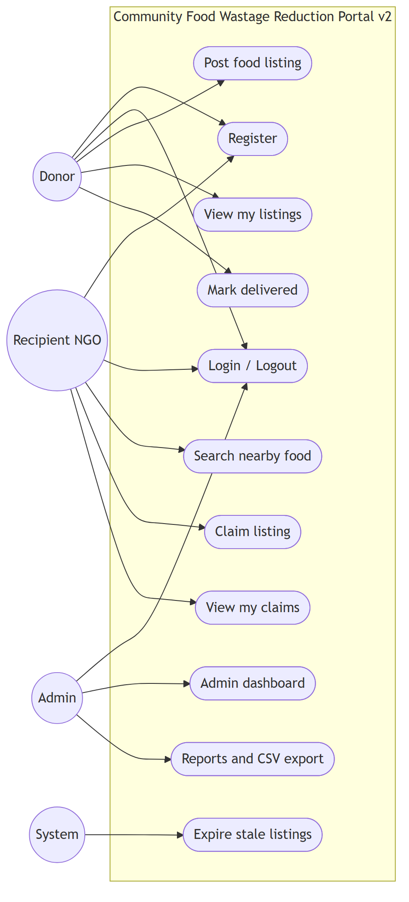
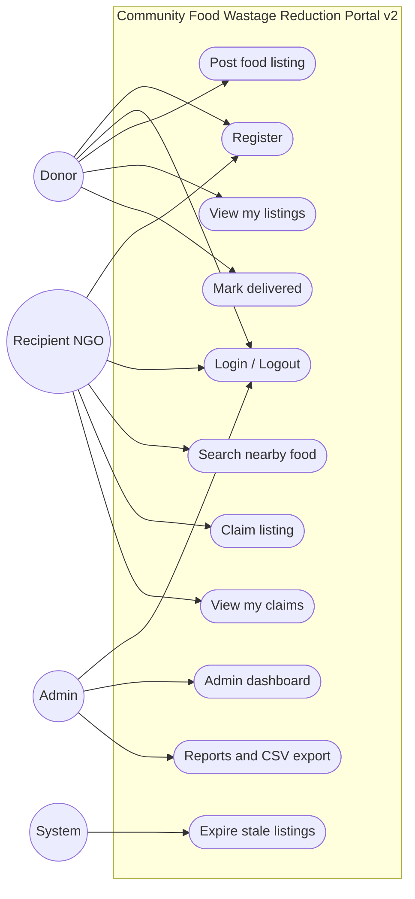

# Figure 4.1 — Use case diagram

**Export target:** `Documentation/images/v2/figure-01-use-case.png`  
**SRS section:** 7 — System models  
**Status:** Rendered → [`figure-01-use-case.png`](../../../images/v2/figure-01-use-case.png)

---

## Purpose

Shows who interacts with the **v2 portal** and the main goals each actor can achieve. Volunteer and dispute use cases are **future** (dashed in diagram) and are not in the current codebase.

---

## System boundary

**Community Food Wastage Reduction Portal (v2)** — web app + MySQL + scheduled expiry job.

---

## Actors

| Actor | Description |
| ----- | ----------- |
| Donor | Posts food, views own listings, marks delivered |
| Recipient (NGO) | Searches nearby food, claims, views claim history |
| Admin | Views dashboard and analytics reports |
| System | Runs hourly expiry sweep (`food:expire`) |

---

## Use cases (implemented)

| ID | Use case | Actor |
| -- | -------- | ----- |
| UC-01 | Register account | Donor, Recipient |
| UC-02 | Login / Logout | Donor, Recipient, Admin |
| UC-03 | Post food listing | Donor |
| UC-04 | View my listings | Donor |
| UC-05 | Mark listing delivered | Donor |
| UC-06 | Search nearby food | Recipient |
| UC-07 | Claim listing | Recipient |
| UC-08 | View my claims | Recipient |
| UC-09 | View admin dashboard | Admin |
| UC-10 | Generate reports / export CSV | Admin |
| UC-11 | Expire stale listings | System |

---

## Text for report (under the figure)

The use case diagram defines actors Donor, Recipient, Admin, and System inside the portal boundary. Donors manage listings and delivery confirmation; recipients search and claim food once; admins analyse live data from MySQL; the system marks expired listings automatically.

---

## Mermaid source

