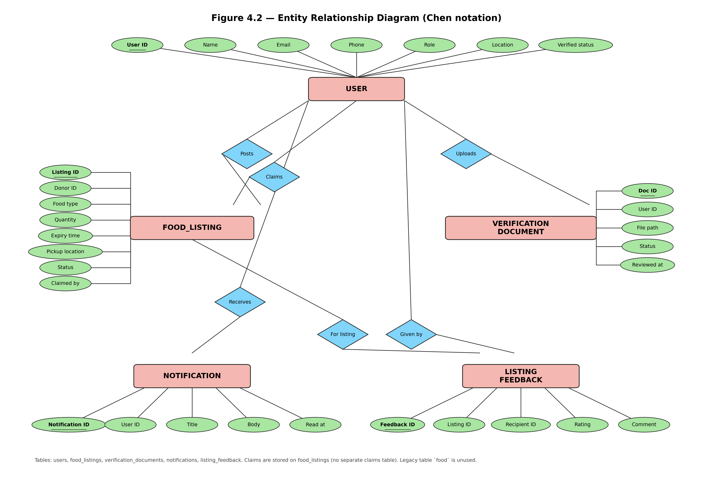
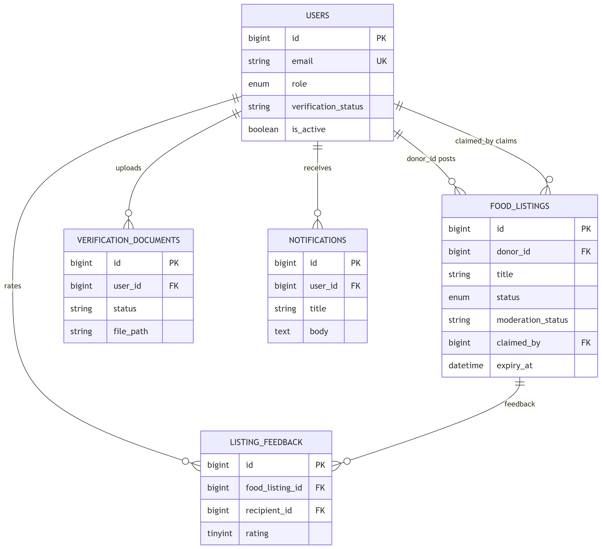
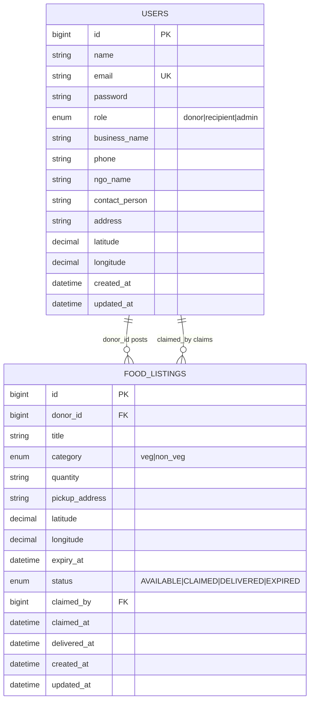

# Figure 4.2 — Entity relationship diagram (implemented database)

**Export targets**

| Style | File |
| ----- | ---- |
| Chen notation (report / viva, like classic ERD handouts) | [`figure-02-erd-chen.png`](../../../images/v2/figure-02-erd-chen.png) |
| Crow’s-foot (Mermaid) | [`figure-02-erd.png`](../../../images/v2/figure-02-erd.png) |

**SRS section:** 6 — Data requirements  

**Regenerate Chen diagram:** `python Documentation/images/v2/source/generate_chen_erd.py`

---

## Purpose

Documents the **actual MySQL schema** used by the Laravel v2 app: `users`, `food_listings`, `verification_documents`, `notifications`, and `listing_feedback`. Claim data is stored on the listing row (`claimed_by`, `claimed_at`), not a separate `claims` table.

---

## Entities

### users

| Column | Key | Notes |
| ------ | --- | ----- |
| id | PK | |
| name, email, password | | |
| role | | donor \| recipient \| admin \| volunteer |
| is_active | | account enabled |
| verification_status | | NGO approval (`pending` / `approved` / `rejected`) |
| business_name, phone | | donor profile |
| ngo_name, contact_person | | recipient profile |
| address, latitude, longitude | | location |
| created_at, updated_at | | |

### food_listings

| Column | Key | Notes |
| ------ | --- | ----- |
| id | PK | |
| donor_id | FK → users.id | cascade delete |
| title, category, quantity | | |
| pickup_address, latitude, longitude | | copied from donor at post |
| expiry_at | | best-before |
| status | | AVAILABLE, CLAIMED, DELIVERED, EXPIRED |
| moderation_status | | PENDING, APPROVED, REJECTED |
| claimed_by | FK → users.id, nullable | recipient |
| claimed_at, delivered_at | nullable | |
| moderated_by | FK → users.id, nullable | admin |
| created_at, updated_at | | |

Index: `(status, expiry_at)` for search and expiry job.

### verification_documents

| Column | Key | Notes |
| ------ | --- | ----- |
| id | PK | |
| user_id | FK → users.id | recipient NGO |
| file_path, original_name | | stored under `storage/app` |
| status | | pending / approved / rejected |
| reviewed_by | FK → users.id, nullable | admin |
| reviewed_at | nullable | |

### notifications

| Column | Key | Notes |
| ------ | --- | ----- |
| id | PK | |
| user_id | FK → users.id | cascade delete |
| title, body | | in-app message |
| read_at | nullable | |

### listing_feedback

| Column | Key | Notes |
| ------ | --- | ----- |
| id | PK | |
| food_listing_id | FK | cascade delete |
| recipient_id | FK → users.id | one row per listing per recipient |
| rating, comment | | after delivery |

---

## Relationships (Chen labels on diagram)

- **USER** — *Posts* → **FOOD_LISTING** (`donor_id`)
- **USER** — *Claims* → **FOOD_LISTING** (`claimed_by`)
- **USER** — *Uploads* → **VERIFICATION_DOCUMENT**
- **USER** — *Receives* → **NOTIFICATION**
- **USER** — *Given by* → **LISTING_FEEDBACK**; **FOOD_LISTING** — *For listing* → **LISTING_FEEDBACK**

---

## Note on legacy table

Migration `food` (name, price, description) exists but is **unused** by application code — omit from ERD or mark deprecated.

---

## Text for report

The ERD shows one central **USER** entity (donor, NGO recipient, admin, volunteer). Donors post **FOOD_LISTING** rows; recipients claim on the same table. NGOs upload **VERIFICATION_DOCUMENT** rows before claiming. **NOTIFICATION** stores dashboard alerts; **LISTING_FEEDBACK** stores ratings after delivery.

---

## Mermaid source

