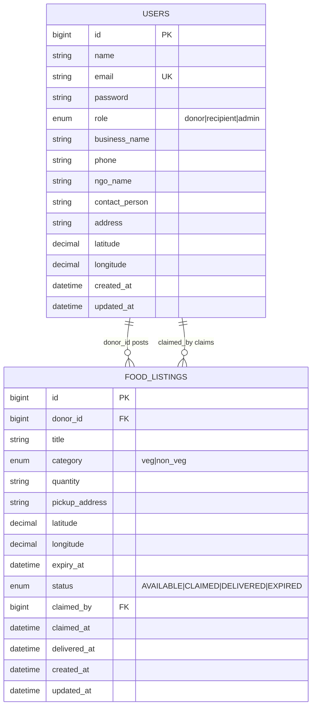

# Figure 4.2 — Entity relationship diagram (implemented database)

**Export target:** `Documentation/images/v2/figure-02-erd.png`  
**SRS section:** 6 — Data requirements  
**Status:** Rendered → [`figure-02-erd.png`](../../../images/v2/figure-02-erd.png)

---

## Purpose

Documents the **actual MySQL schema** used by the Laravel v2 app: `users` and `food_listings`. Claim data is stored on the listing row (`claimed_by`, `claimed_at`), not a separate `claims` table.

---

## Entities

### users

| Column | Key | Notes |
| ------ | --- | ----- |
| id | PK | |
| name, email, password | | |
| role | | donor \| recipient \| admin |
| business_name, phone | | donor profile |
| ngo_name, contact_person | | recipient profile |
| address, latitude, longitude | | location |
| created_at, updated_at | | |

### food_listings

| Column | Key | Notes |
| ------ | --- | ----- |
| id | PK | |
| donor_id | FK → users.id | cascade delete |
| title, category, quantity | | |
| pickup_address, latitude, longitude | | copied from donor at post |
| expiry_at | | best-before |
| status | | AVAILABLE, CLAIMED, DELIVERED, EXPIRED |
| claimed_by | FK → users.id, nullable | recipient |
| claimed_at, delivered_at | nullable | |
| created_at, updated_at | | |

Index: `(status, expiry_at)` for search and expiry job.

---

## Relationships

- **User (donor)** 1 —— * **Food listing** via `donor_id`
- **User (recipient)** 0..1 —— * **Food listing** via `claimed_by` (only when claimed)

---

## Note on legacy table

Migration `food` (name, price, description) exists but is **unused** by application code — omit from ERD or mark deprecated.

---

## Text for report

The ERD shows two main entities. Donors create many food listings. Each listing can be claimed by at most one recipient; status and timestamps record the lifecycle for reporting.

---

## Mermaid source

