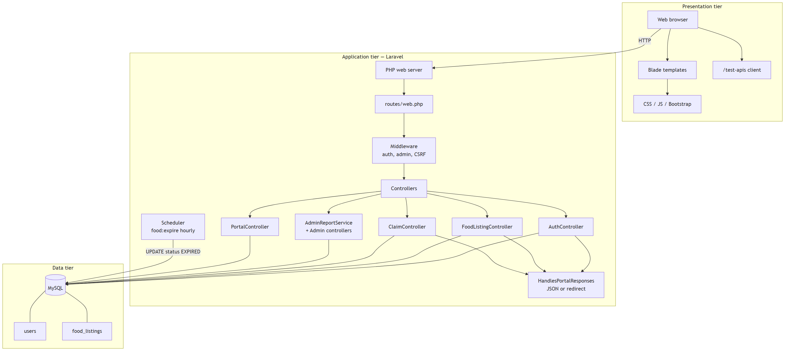
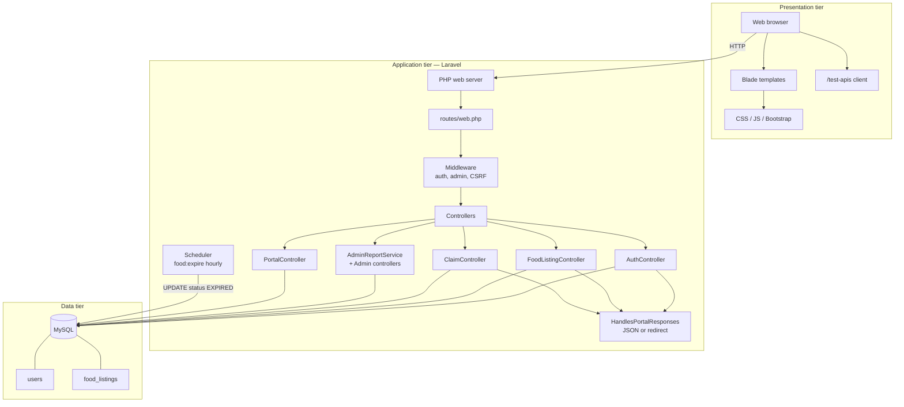

# Figure 4.3 — System architecture (three-tier)

**Export target:** `Documentation/images/v2/figure-03-system-architecture.png`  
**SRS section:** 2.1 — Product perspective  
**Status:** Rendered → [`figure-03-system-architecture.png`](../../../images/v2/figure-03-system-architecture.png)

---

## Purpose

Shows how the browser, Laravel application, and MySQL fit together for v2, including the scheduler for listing expiry and the dual HTML/JSON response path.

---

## Tiers

| Tier | Components |
| ---- | ------------ |
| Presentation | Browser, Blade views, Bootstrap, `public/css` & `public/js`, optional `/test-apis` client |
| Application | `web.php` routes, middleware (`auth`, `admin`), controllers, `AdminReportService`, Eloquent/Query Builder |
| Data | MySQL (`users`, `food_listings`) |
| Background | Laravel scheduler → `php artisan food:expire` hourly |

---

## Main controllers (v2)

| Controller | Responsibility |
| ---------- | -------------- |
| AuthController | Register, login, logout |
| FoodListingController | Store, search, mine, claims, deliver |
| ClaimController | Atomic claim |
| PortalController | GET-only HTML shells |
| AdminDashboardController / AdminReportController | Admin UI |
| ApiTestController | API playground |

---

## Text for report

Users access the portal through a web browser. Laravel handles routing, authentication, and business rules. All persistent data lives in MySQL. A scheduled command updates expired listings so search results stay accurate.

---

## Mermaid source

