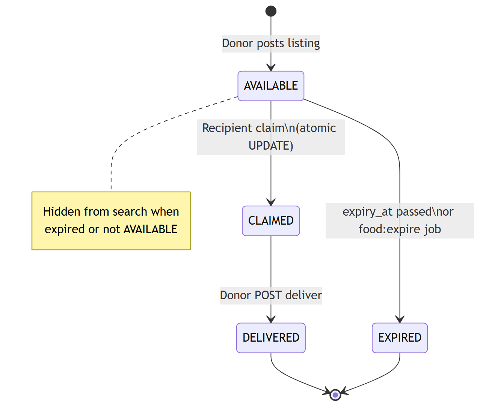
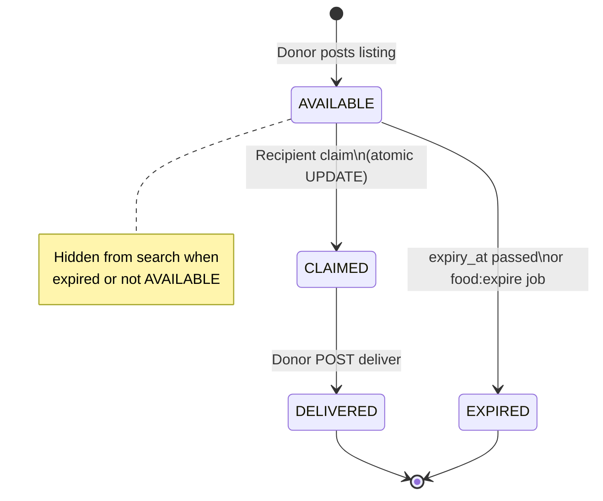

# Figure 4.4 — Food listing state diagram

**Export target:** `Documentation/images/v2/figure-04-listing-state.png`  
**SRS section:** 3.2 / 3.3 — Listing lifecycle  
**Status:** Rendered → [`figure-04-listing-state.png`](../../../images/v2/figure-04-listing-state.png)

---

## Purpose

Defines allowed **status** values on `food_listings.status` and what triggers each transition in v2.

---

## States

| State | Meaning |
| ----- | ------- |
| AVAILABLE | Visible in search; claimable if `expiry_at > now()` |
| CLAIMED | Reserved by one recipient |
| DELIVERED | Donor confirmed pickup |
| EXPIRED | Past best-before while still available, or set by batch job |

---

## Transitions

| From | Event | To | Actor / system |
| ---- | ----- | -- | -------------- |
| — | Donor posts listing | AVAILABLE | Donor (`POST /food`) |
| AVAILABLE | Recipient claim succeeds | CLAIMED | Recipient |
| AVAILABLE | Time passes / `food:expire` | EXPIRED | System |
| AVAILABLE | Claim fails (race/expiry) | AVAILABLE | — (no change) |
| CLAIMED | Donor marks delivered | DELIVERED | Donor |
| CLAIMED | (future: cancel) | AVAILABLE | Planned |

**Invalid:** DELIVERED → anything; EXPIRED → CLAIMED without new listing.

---

## Text for report

Each listing starts AVAILABLE. A successful claim moves it to CLAIMED. The donor marks DELIVERED after pickup. If nobody claims before expiry, the listing becomes EXPIRED and disappears from search.

---

## Mermaid source

