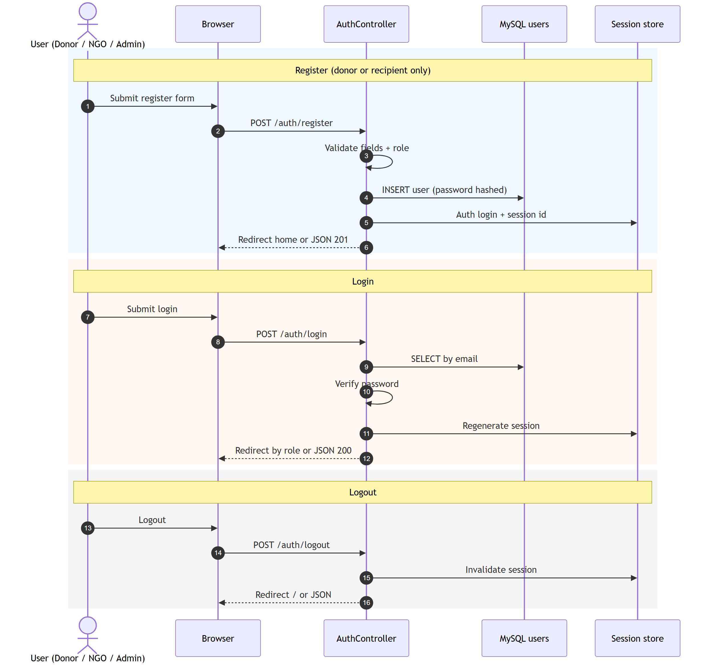
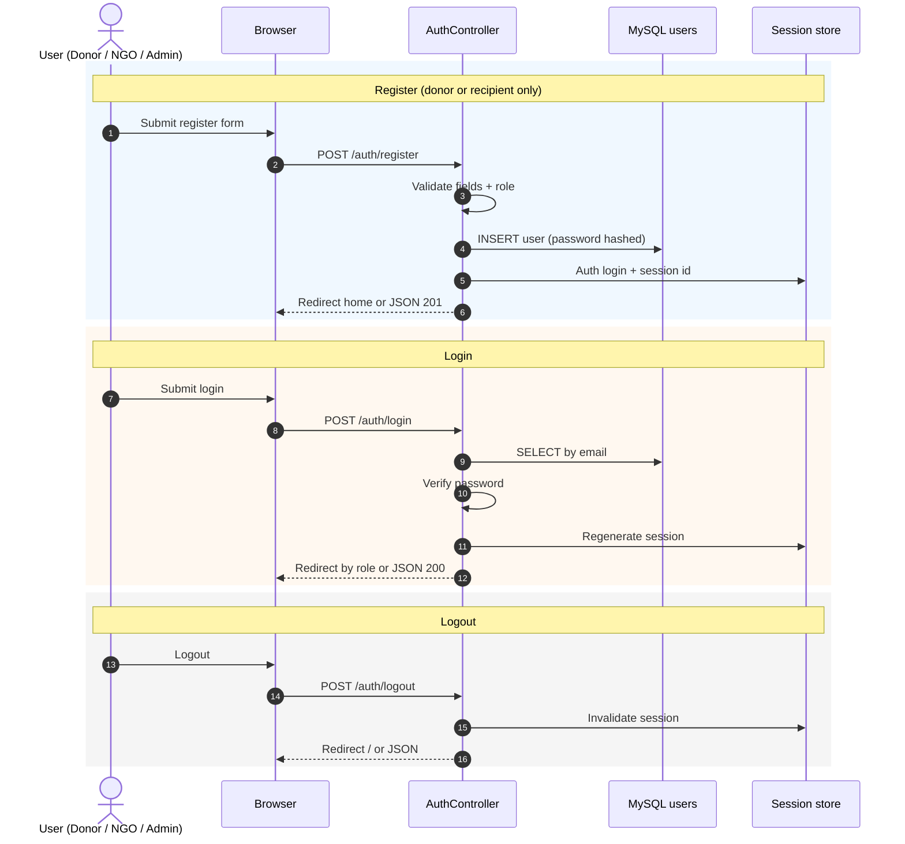

# Figure 4.5 — Sequence diagram: authentication

**Export target:** `Documentation/images/v2/figure-05-sequence-auth.png`  
**SRS section:** 3.1 — FR-A01–A05  
**Status:** Rendered → [`figure-05-sequence-auth.png`](../../../images/v2/figure-05-sequence-auth.png)

---

## Purpose

Register, login, and logout using **session-based auth** (`AuthController`). Same endpoints serve HTML forms and JSON (Postman).

---

## Participants

- Donor / Recipient / Admin (actor)
- Browser
- AuthController
- User model / MySQL `users`
- Session store

---

## Main flows

1. **Register** — validate → hash password → insert user → `Auth::login` → redirect or JSON 201  
2. **Login** — validate credentials → regenerate session → redirect by role  
3. **Logout** — invalidate session → redirect home  

Admin is not accepted on `role` during public register (validation allows only donor/recipient).

---

## Text for report

The user submits registration or login through the browser. AuthController validates input, reads or writes the users table, and starts or ends a Laravel session. After login, donors, recipients, and admins are sent to their respective home pages.

---

## Mermaid source

