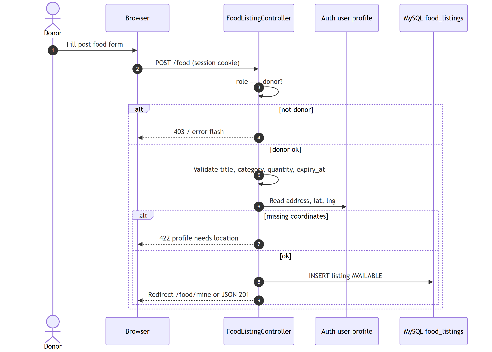
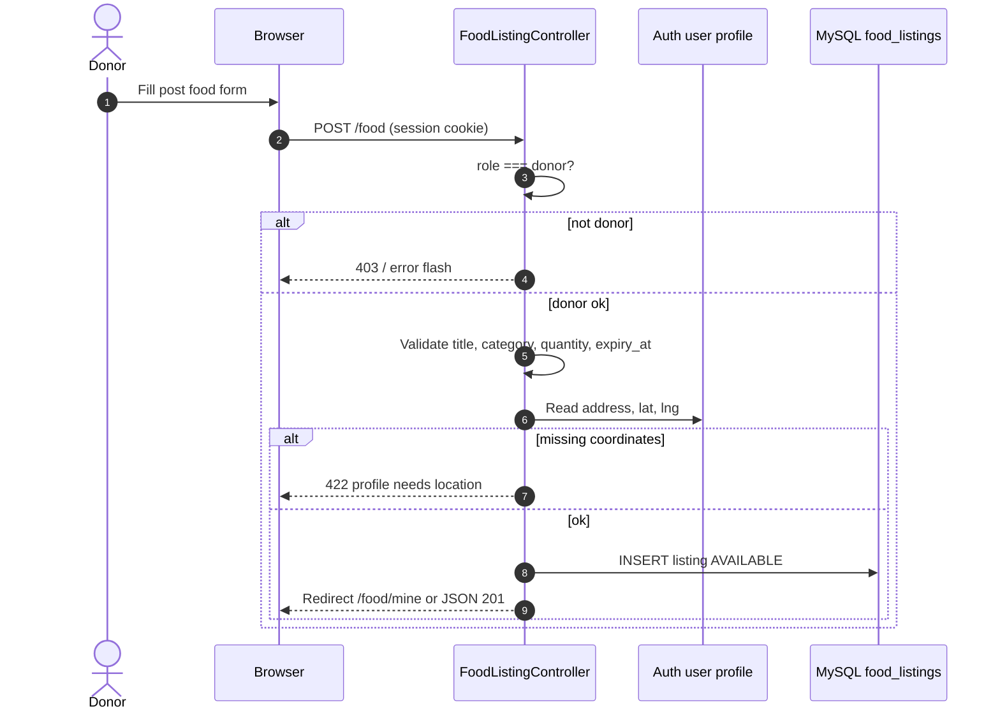

# Figure 4.6 — Sequence diagram: donor posts food listing

**Export target:** `Documentation/images/v2/figure-06-sequence-post-listing.png`  
**SRS section:** 3.2 — FR-D01–D03  
**Status:** Rendered → [`figure-06-sequence-post-listing.png`](../../../images/v2/figure-06-sequence-post-listing.png)

---

## Purpose

Donor creates a row in `food_listings` with status **AVAILABLE**. Pickup location is taken from the logged-in donor profile, not from separate map fields on the listing form.

---

## Preconditions

- User authenticated as **donor**
- Donor has `latitude` and `longitude` set (usually at registration)

---

## Postconditions

- New listing with `status = AVAILABLE`
- `pickup_address`, lat/lng copied from donor

---

## Text for report

The donor submits title, category, quantity, and expiry. FoodListingController checks the donor role and profile coordinates, then inserts the listing. The donor is redirected to my listings or receives JSON with the new record.

---

## Mermaid source

