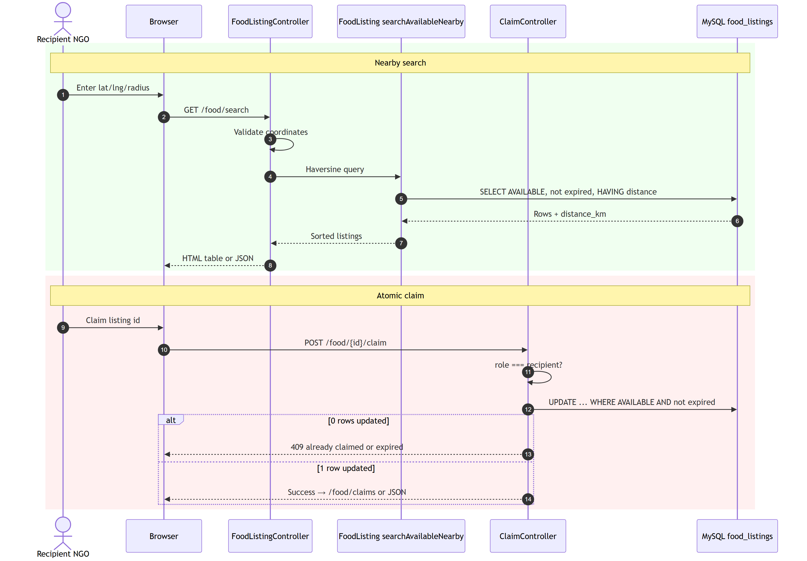
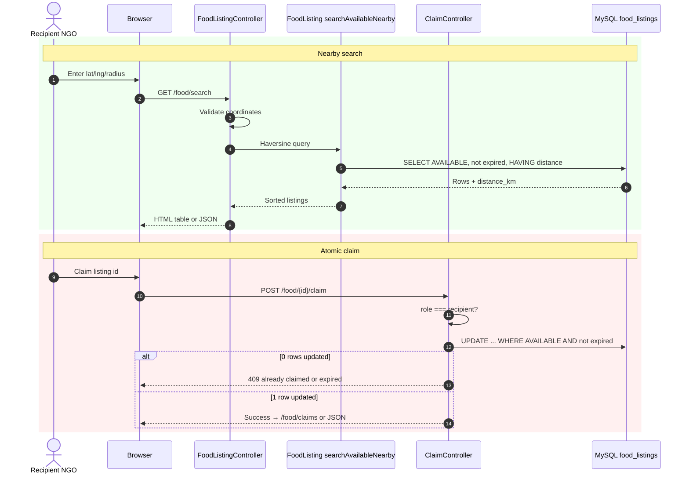

# Figure 4.7 — Sequence diagram: nearby search and atomic claim

**Export target:** `Documentation/images/v2/figure-07-sequence-search-claim.png`  
**SRS section:** 3.3 — FR-R01–R03, NFR-02  
**Status:** Rendered → [`figure-07-sequence-search-claim.png`](../../../images/v2/figure-07-sequence-search-claim.png)



---

## Purpose

Recipient finds food within a radius using **Haversine** distance in SQL, then claims one listing. Concurrent claims must result in **at most one success** (Challenge 2).

---

## Search rules

- `status = AVAILABLE`
- `expiry_at > now()`
- `distance_km <= radius_km`
- Order by `distance_km` ascending

---

## Claim rules

Single update:

```sql
UPDATE food_listings
SET status = 'CLAIMED', claimed_by = ?, claimed_at = NOW()
WHERE id = ? AND status = 'AVAILABLE' AND expiry_at > NOW()
```

If affected rows = 0 → HTTP **409** (already claimed or expired).

---

## Text for report

The recipient searches with GPS and radius. The server returns nearby available listings. On claim, one atomic update sets the status to CLAIMED; a second simultaneous claim gets an error instead of double-booking.

---

## Mermaid source


