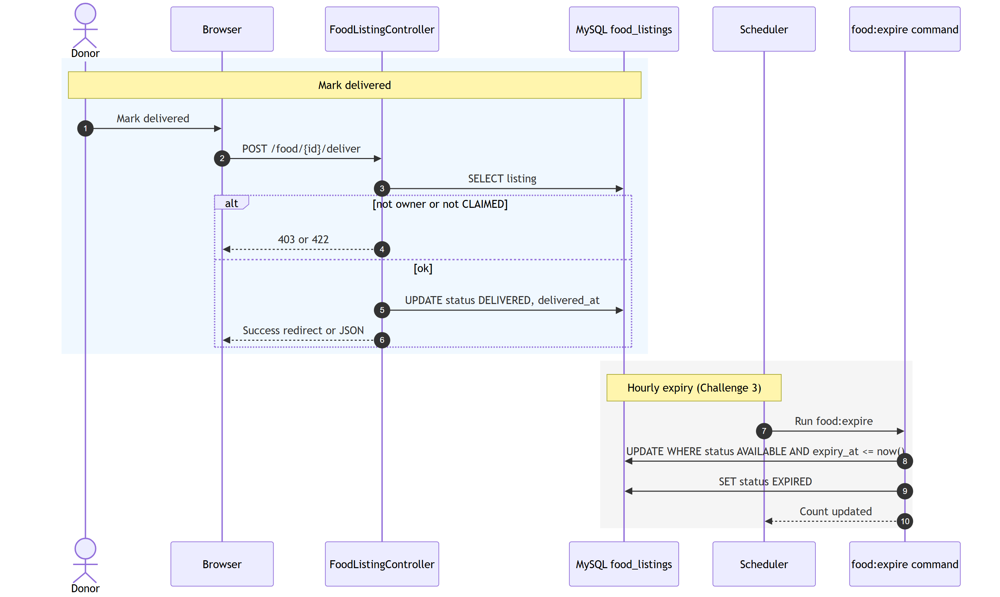
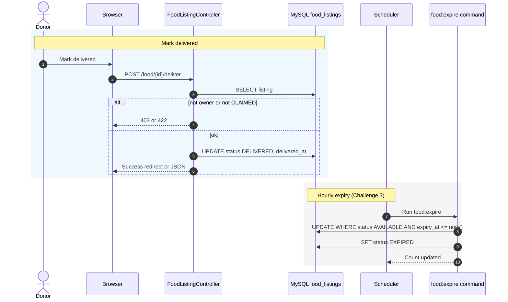

# Figure 4.8 — Sequence diagram: mark delivered and expiry job

**Export target:** `Documentation/images/v2/figure-08-sequence-deliver-expire.png`  
**SRS section:** 3.2 / 3.5 — FR-D05, FR-S01–S02  
**Status:** Rendered → [`figure-08-sequence-deliver-expire.png`](../../../images/v2/figure-08-sequence-deliver-expire.png)

---

## Purpose

Two related flows:

1. **Donor** confirms pickup → **DELIVERED**  
2. **System** hourly job marks overdue **AVAILABLE** rows as **EXPIRED** (Challenge 3)

Lazy expiry: search/claim already filter `expiry_at > now()` even before the job runs.

---

## Deliver preconditions

- Authenticated donor owns the listing (`donor_id`)
- Current status is **CLAIMED**

---

## Text for report

After pickup, the donor marks the listing delivered. Separately, a scheduled command scans for available listings past their expiry time and sets them to EXPIRED so reports and data stay consistent.

---

## Mermaid source

