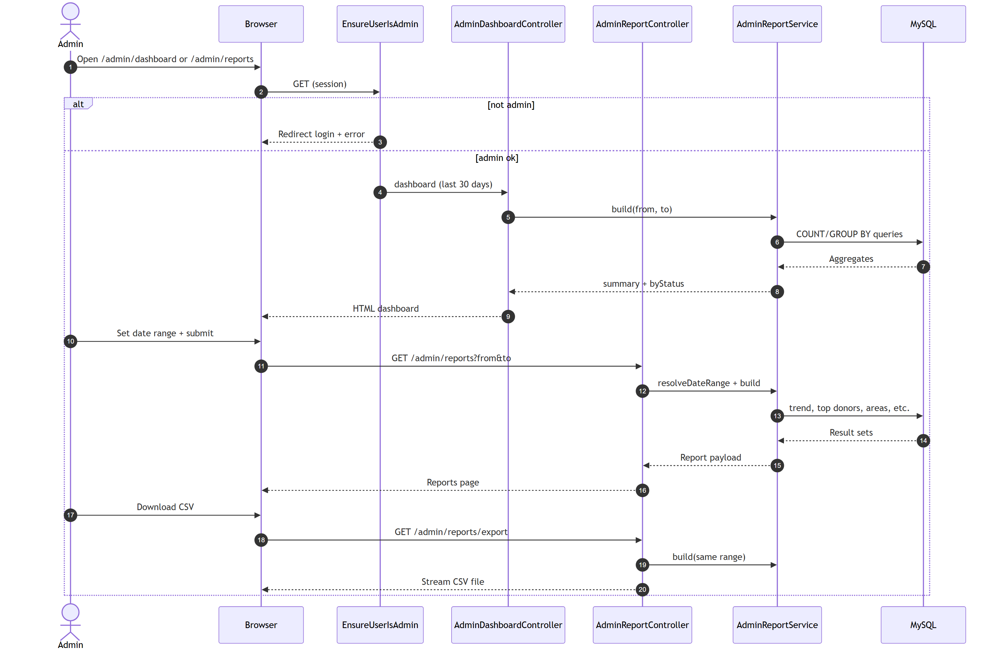
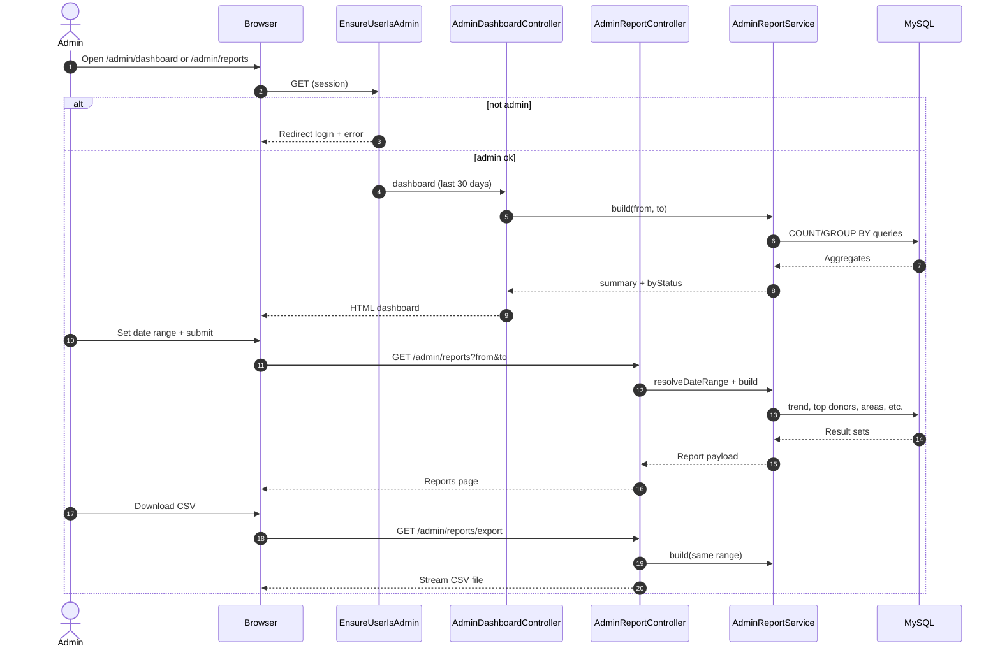

# Figure 4.9 — Sequence diagram: admin reports

**Export target:** `Documentation/images/v2/figure-09-sequence-admin-reports.png`  
**SRS section:** 3.4 — FR-M01–M04  
**Status:** Rendered → [`figure-09-sequence-admin-reports.png`](../../../images/v2/figure-09-sequence-admin-reports.png)

---

## Purpose

Admin views aggregated analytics from live MySQL data. Access is gated by **auth + admin middleware**. Reports support date filters and CSV download.

---

## Participants

- Admin user
- `EnsureUserIsAdmin` middleware
- `AdminReportController` / `AdminDashboardController`
- `AdminReportService` (SQL aggregations)
- MySQL

---

## Report outputs (summary)

- KPIs: totals, claim rate, delivery rate, new users
- Breakdowns: status, category, daily trend, top pickup areas, top donors/NGOs
- CSV export of summary tables

---

## Text for report

The admin opens the reports page after passing role checks. AdminReportService runs grouped queries on food_listings and users for the selected dates. Results render in Blade charts and tables; optional CSV streams the same aggregates for offline analysis.

---

## Mermaid source

