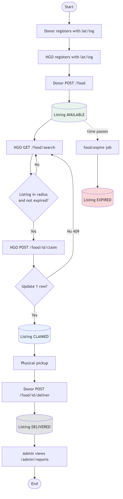
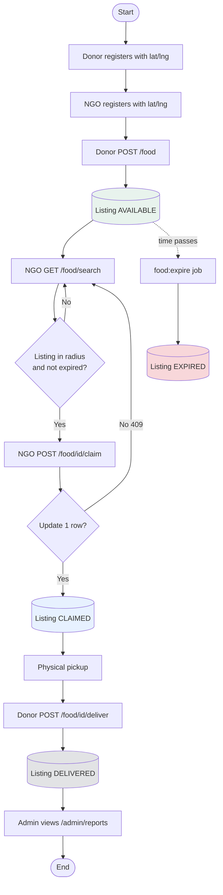

# Figure 4.10 — Activity diagram: end-to-end happy path

**Export target:** `Documentation/images/v2/figure-10-end-to-end-flow.png`  
**SRS section:** 8 — Traceability / overview  
**Status:** Rendered → [`figure-10-end-to-end-flow.png`](../../../images/v2/figure-10-end-to-end-flow.png)

---

## Purpose

Single overview from **empty system** through a complete donation cycle, including admin visibility. Matches assignment v2 demo flow for viva/report introduction.

---

## Happy path steps

1. Donor registers with location  
2. Recipient (NGO) registers with location  
3. Donor posts listing → AVAILABLE  
4. NGO searches nearby → sees listing  
5. NGO claims → CLAIMED  
6. Donor marks delivered → DELIVERED  
7. Admin opens reports → sees listing in aggregates  
8. (Parallel) Scheduler may EXPIRE other untouched listings  

---

## Text for report

This activity diagram summarises the main success path: both parties register, the donor lists food, the NGO claims it once, the donor confirms delivery, and the admin can measure impact through the reporting module.

---

## Mermaid source

